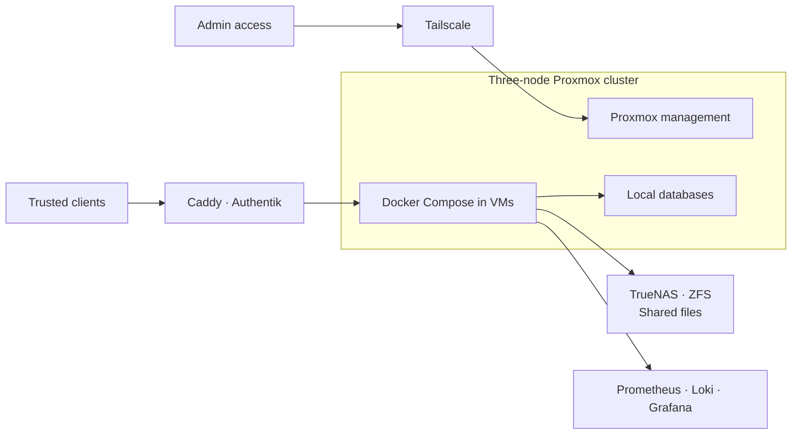

# Tamriel Homelab

Tamriel is my three-node Proxmox homelab. I use it to run personal services and
work on security projects. This repo has notes on the setup, scripts, and
configuration examples from building it.

## The setup

Most services run with Docker Compose inside Debian VMs, grouped by role.
Databases live on the VMs' own disks; shared storage holds bulk files.
Administration goes through Tailscale, and web applications use Caddy with
Authentik for sign-in where supported.

[More about the setup](docs/architecture.md) ·
[Networking](docs/network-and-identity.md)

## What's running

The lab hosts file sync, photos, documents, a password vault, search, media, and
development services. Supporting those:

| Job | Tools |
|---|---|
| Networking and access | OPNsense, Tailscale, Caddy, Authentik |
| Storage and backups | TrueNAS, ZFS, Proxmox Backup Server, Restic |
| Git and updates | Forgejo, Renovate, Ansible |
| Metrics, logs, and alerts | Prometheus, Loki, Grafana, Alertmanager |
| Security | Trivy, Falco, CrowdSec, ClamAV |

## Automation

Each folder has its own setup and test commands:

- [Trivy](automation/trivy/) — scan images and repositories; alert on new vulnerabilities and available fixes.
- [Ansible](automation/ansible/) — configure SSH and updates; upgrade one host at a time.
- [Deployment](automation/ci/) — deploy the commit that passed CI and roll back if health checks fail.
- [Falco](automation/falco/) — detect suspicious runtime activity and send events to Loki and Alertmanager.
- [Grafana](automation/monitoring/) — a dashboard for scan results and Falco events.
- [Recovery](automation/recovery/) — test restores with generated archives and check storage before starting services.

## Screenshots

The lab's Trivy dashboard. The secret panel reports file scans; Git history is
checked separately. [More screenshots](evidence/screenshots/README.md).

## Notes

- [Making vulnerability alerts useful](docs/case-studies/actionable-vulnerability-management.md)
- [Deploying the commit that passed CI](docs/case-studies/fail-closed-infrastructure-delivery.md)
- [Restoring without overwriting live data](docs/case-studies/recovery-and-storage-dependencies.md)
- [Next steps](ROADMAP.md)
