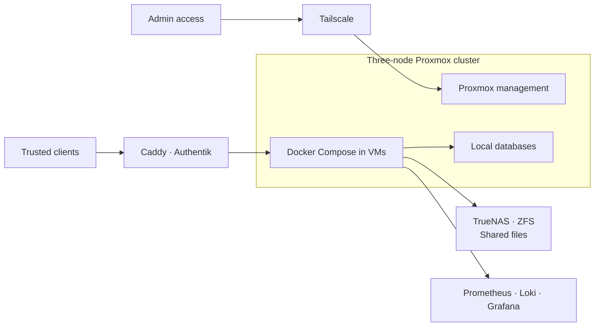

# Tamriel Homelab

Tamriel is my three-node Proxmox homelab. I use it to run personal services and
work on security projects. Most services run in Docker on Debian VMs, with
TrueNAS for shared files and OPNsense handling the network. This repo has notes
on the setup, screenshots, scripts, and configuration examples from building it.

## Table of Contents

- [Apps](apps/) - Apps and services running in the lab.
- [Media](media/) - Jellyfin, Seerr, the *arr stack, and GPU transcoding.
- [Proxmox](proxmox/) - Proxmox cluster and virtual machine setup.
- [Networking](networking/) - Firewall, DNS, remote access, and sign-in.
- [Storage](storage/) - Current storage and backup setup.
- [Monitoring](monitoring/) - Grafana dashboards, metrics, logs, and alerts.
- [Security](security/) - Trivy, Falco, CrowdSec, and ClamAV.
- [Automation](automation/) - Forgejo, Renovate, Ansible, and deployment scripts.

## The setup

Most services run with Docker Compose inside Debian VMs, grouped by role.
Databases live on the VMs' own disks; shared storage holds bulk files.
Administration goes through Tailscale, and web applications use Caddy with
Authentik for sign-in where supported.

[More about the setup](docs/architecture.md) ·
[The Proxmox cluster](proxmox/README.md)

## Hardware

### Compute

| Hardware | Specs | Use |
|---|---|---|
| GMKtec NucBox K10 | Core i9-13900HK, 32 GB DDR5, 1 TB NVMe | Proxmox node |
| ACEMAGIC K1 | Intel N95, 16 GB DDR4, 1 TB SATA SSD | Proxmox node |
| ASUS ROG Ally | Ryzen Z1 Extreme, 16 GB LPDDR5, 512 GB NVMe | Proxmox node with GPU passthrough for media |

[How I group the workloads](proxmox/README.md#virtual-machines)

### Storage

| Hardware | Specs | Use |
|---|---|---|
| UGREEN DXP4800 Plus | Pentium Gold 8505, 8 GB RAM, 128 GB NVMe, 4 × 4 TB Seagate ST4000VN006 HDDs | TrueNAS SCALE storage |

The NAS hard drives are arranged as two mirrored pairs.
[Storage and backup notes](storage/README.md)

### Networking

| Hardware | Specs | Use |
|---|---|---|
| Lenovo ThinkCentre M720q | Core i5-8500T, 8 GB RAM, 256 GB SSD, Intel i350-T4 NIC | OPNsense router/firewall |
| Ubiquiti USW-Lite-16-PoE | 16-port managed PoE switch | Wired networking |
| Ubiquiti U6-Plus | Wi-Fi 6 access point | Wireless networking |

### Supporting devices

| Hardware | Specs | Use |
|---|---|---|
| Raspberry Pi 5 | 16 GB RAM, 128 GB microSD | DNS, reverse proxy, and cluster quorum device |
| CyberPower CP1500PFCLCD | 1500 VA / 1000 W | UPS power protection |

## What's running

I use Syncthing for documents and notes, Immich for photos, FreshRSS for reading,
and Jellyfin for media. Homarr brings the service links and reading brief together.

| Job | Tools |
|---|---|
| Files, photos, and documents | [Syncthing, Immich, Stirling PDF](apps/README.md#files-photos-and-documents) |
| Reading and utilities | [FreshRSS, Homarr, Vaultwarden, SearXNG](apps/README.md#reading-and-utilities) |
| Media | [Jellyfin, Seerr, Servarr, Gluetun](media/README.md) |
| Networking and access | [OPNsense, Tailscale, Caddy, Authentik](apps/README.md#networking-and-sign-in) |
| Storage and backups | [TrueNAS, ZFS, Proxmox Backup Server, Restic](apps/README.md#storage-and-backups) |
| Git and updates | [Forgejo, Renovate, Ansible](apps/README.md#git-and-updates) |
| Metrics, logs, and alerts | [Prometheus, Loki, Grafana, Alertmanager](apps/README.md#dashboards-and-monitoring) |
| Security | [Trivy, Falco, CrowdSec, ClamAV](apps/README.md#security) |

There are also a few [small projects](apps/projects/README.md): a VM provisioning
portal, Discord actions for media requests, a reading brief, and a printer monitor.

## Setup guides

Each guide lists its requirements and the files to use. If you already cloned
this repo, copy the linked example files into your own working directory instead
of downloading them again.

| Start with | Guide |
|---|---|
| A VM for your containers | [Debian on Proxmox](proxmox/debian-vm/README.md), [Terraform clone](proxmox/terraform/README.md) |
| Shared storage and backups | [TrueNAS and NFS](storage/nfs/README.md), [PBS](storage/pbs/README.md), [Restic](storage/restic/README.md) |
| Private application access | [Pi-hole and Unbound](networking/dns/README.md), [Caddy, Tailscale, and Authentik](networking/private-access/README.md) |
| Photos, reading, and a homepage | [Immich](apps/immich/README.md), [FreshRSS](apps/freshrss/README.md), [Homarr](apps/homarr/README.md) |
| Media requests and playback | [Download stack](media/servarr/README.md), [Jellyfin and GPU transcoding](media/jellyfin/README.md) |
| Passwords, search, and utilities | [Vaultwarden, SearXNG, Stirling PDF, OpenSpeedTest](apps/utilities/README.md) |
| Dashboards and notifications | [Host metrics and alerts](monitoring/host-metrics/README.md), [Loki and Alloy](monitoring/logs/README.md), [Uptime Kuma](monitoring/uptime-kuma/README.md) |
| Security tools | [CrowdSec](security/crowdsec/README.md), [ClamAV](security/clamav/README.md), [Trivy](automation/trivy/README.md), [Falco](automation/falco/README.md) |

## Automation

Forgejo hosts the lab's private configuration repositories, and Renovate opens
dependency-update pull requests. I review updates before applying them. Ansible
handles host configuration, and scripts connect security scans to Grafana and
notifications.

[Git and deployment workflow](automation/README.md) ·
[Set up Renovate](automation/renovate/README.md) ·
[Host maintenance](automation/ansible/README.md)

## Screenshots

A landscape album in Immich. More captures are beside the app descriptions and
in the [screenshot gallery](screenshots/README.md), including FreshRSS,
Jellyfin, Seerr, Grafana, TrueNAS, and PBS.

## Notes

- [Making vulnerability alerts useful](docs/case-studies/actionable-vulnerability-management.md)
- [Deploying the commit that passed CI](docs/case-studies/fail-closed-infrastructure-delivery.md)
- [Restoring without overwriting live data](docs/case-studies/recovery-and-storage-dependencies.md)
- [Setup guide checks](docs/drills/setup-guide-checks.md)
- [Next steps](ROADMAP.md)
