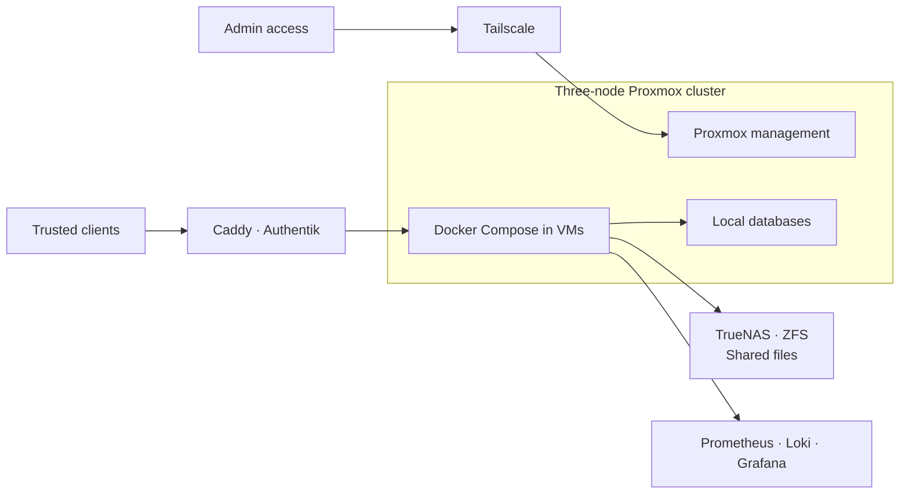
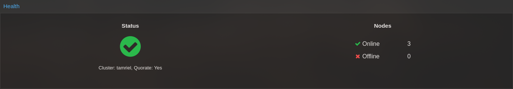
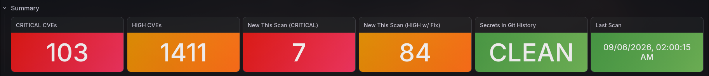

# Tamriel Homelab

Tamriel is my three-node Proxmox homelab. I use it to run personal services and
work on security projects. Most services run in Docker on Debian VMs, with
TrueNAS for shared files and OPNsense handling the network. This repo has notes
on the setup, screenshots, scripts, and configuration examples from building it.

## Table of Contents

- [Apps](apps/) - Apps and services running in the lab.
- [Media](media/) - Jellyfin, Seerr, the *arr stack, and GPU transcoding.
- [Proxmox](proxmox/) - Proxmox cluster and virtual machine setup.
- [Networking](networking/) - Firewall, DNS, remote access, and sign-in.
- [Storage](storage/) - Current storage and backup setup.
- [Monitoring](monitoring/) - Grafana dashboards, metrics, logs, and alerts.
- [Security](security/) - Trivy, Falco, CrowdSec, and ClamAV.
- [Automation](automation/) - Forgejo, Renovate, Ansible, and deployment scripts.

## The setup

Most services run with Docker Compose inside Debian VMs, grouped by role.
Databases live on the VMs' own disks; shared storage holds bulk files.
Administration goes through Tailscale, and web applications use Caddy with
Authentik for sign-in where supported.

[More about the setup](docs/architecture.md) ·
[The Proxmox cluster](proxmox/README.md)

## Hardware

### Compute

| Hardware | Specs | Use |
|---|---|---|
| GMKtec NucBox K10 | Core i9-13900HK, 32 GB DDR5, 1 TB NVMe | Proxmox node |
| ACEMAGIC K1 | Intel N95, 16 GB DDR4, 1 TB SATA SSD | Proxmox node |
| ASUS ROG Ally | Ryzen Z1 Extreme, 16 GB LPDDR5, 512 GB NVMe | Proxmox node with GPU passthrough for media |

[How I group the workloads](proxmox/README.md#virtual-machines)

### Storage

| Hardware | Specs | Use |
|---|---|---|
| UGREEN DXP4800 Plus | Pentium Gold 8505, 8 GB RAM, 128 GB NVMe, 4 × 4 TB Seagate ST4000VN006 HDDs | TrueNAS SCALE storage |

The NAS hard drives are arranged as two mirrored pairs.
[Storage and backup notes](storage/README.md)

### Networking

| Hardware | Specs | Use |
|---|---|---|
| Lenovo ThinkCentre M720q | Core i5-8500T, 8 GB RAM, 256 GB SSD, Intel i350-T4 NIC | OPNsense router/firewall |
| Ubiquiti USW-Lite-16-PoE | 16-port managed PoE switch | Wired networking |
| Ubiquiti U6-Plus | Wi-Fi 6 access point | Wireless networking |

### Supporting devices

| Hardware | Specs | Use |
|---|---|---|
| Raspberry Pi 5 | 16 GB RAM, 128 GB microSD | DNS, reverse proxy, and cluster quorum device |
| CyberPower CP1500PFCLCD | 1500 VA / 1000 W | UPS power protection |

## What's running

I use Syncthing for documents and notes, Immich for photos, FreshRSS for reading,
and Jellyfin for media. Homarr brings the service links and reading brief together.

| Job | Tools |
|---|---|
| Files, photos, and documents | [Syncthing, Immich, Stirling PDF](apps/README.md#files-photos-and-documents) |
| Reading and utilities | [FreshRSS, Homarr, Vaultwarden, SearXNG](apps/README.md#reading-and-utilities) |
| Media | [Jellyfin, Seerr, Servarr, Gluetun](media/README.md) |
| Networking and access | [OPNsense, Tailscale, Caddy, Authentik](apps/README.md#networking-and-sign-in) |
| Storage and backups | [TrueNAS, ZFS, Proxmox Backup Server, Restic](apps/README.md#storage-and-backups) |
| Git and updates | [Forgejo, Renovate, Ansible](apps/README.md#git-and-updates) |
| Metrics, logs, and alerts | [Prometheus, Loki, Grafana, Alertmanager](apps/README.md#dashboards-and-monitoring) |
| Security | [Trivy, Falco, CrowdSec, ClamAV](apps/README.md#security) |

There are also a few [small projects](apps/projects/README.md): a VM provisioning
portal, Discord actions for media requests, a reading brief, and a printer monitor.

## Automation

Forgejo hosts the lab's private configuration repositories, and Renovate opens
dependency-update pull requests. The [automation page](automation/README.md)
connects that workflow to the deployment, host maintenance, scanning, and restore
examples. Each example has its own setup and test commands.

For smaller starting points, try the [Syncthing example](apps/syncthing/README.md),
[Caddy proxy](networking/caddy/README.md), or
[host-monitoring stack](monitoring/host-metrics/README.md).

GitHub Actions checks links, publication rules, and secrets on each push. Changes
to automation also run the relevant tests. Container builds and integration
checks run manually from [Actions](https://github.com/arviiyer/tamriel-homelab/actions/workflows/integration.yml).

## Screenshots

Three Proxmox nodes online with quorum established.

The lab's Trivy dashboard. The secret panel reports file scans; Git history is
checked separately. [Monitoring setup](monitoring/README.md) ·
[More screenshots](evidence/screenshots/README.md)

## Notes

- [Making vulnerability alerts useful](docs/case-studies/actionable-vulnerability-management.md)
- [Deploying the commit that passed CI](docs/case-studies/fail-closed-infrastructure-delivery.md)
- [Restoring without overwriting live data](docs/case-studies/recovery-and-storage-dependencies.md)
- [Documentation plan](docs/documentation-plan.md)
- [Next steps](ROADMAP.md)
