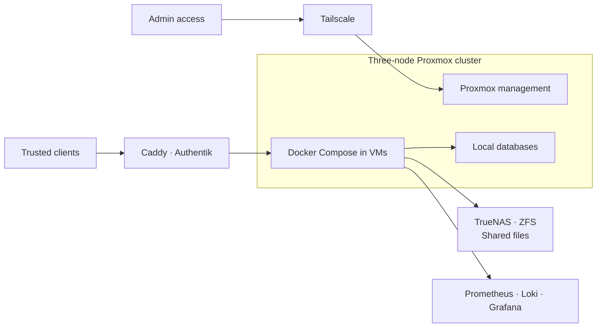

# Tamriel Homelab

Tamriel is my three-node Proxmox homelab. I use it to run personal services and
work on security projects. Most services run in Docker on Debian VMs, with
TrueNAS for shared files and OPNsense handling the network. This repo has notes
on the setup, screenshots, scripts, and configuration examples from building it.

## Table of Contents

- [Apps](apps/) - Apps and services running in the lab.
- [Projects](projects/) - Tools I've built around the lab.
- [Media](media/) - Jellyfin, Seerr, the *arr stack, and GPU transcoding.
- [Proxmox](proxmox/) - Proxmox cluster and virtual machine setup.
- [Networking](networking/) - Firewall, DNS, remote access, and sign-in.
- [Storage](storage/) - Current storage and backup setup.
- [Monitoring](monitoring/) - Grafana dashboards, metrics, logs, and alerts.
- [Security](security/) - Trivy, Falco, CrowdSec, and ClamAV.
- [Automation](automation/) - Forgejo, Renovate, Ansible, and deployment scripts.

## The setup

I group Docker Compose services into Debian VMs by role. The ROG Ally passes
its GPU to the media VM, while the Raspberry Pi runs DNS and the reverse proxy.
Databases live on the VMs' own disks; TrueNAS holds photos, synced files, and media.
I reach the lab through Tailscale when away from home.

[More about the setup](docs/architecture.md) ·
[The Proxmox cluster](proxmox/README.md)

## Hardware

### Compute

| Hardware | Specs | Use |
|---|---|---|
| GMKtec NucBox K10 | Core i9-13900HK, 32 GB DDR5, 1 TB NVMe | Proxmox node |
| ACEMAGIC K1 | Intel N95, 16 GB DDR4, 1 TB SATA SSD | Proxmox node |
| ASUS ROG Ally | Ryzen Z1 Extreme, 16 GB LPDDR5, 512 GB NVMe | Proxmox node with GPU passthrough for media |

[How I group the workloads](proxmox/README.md#virtual-machines)

### Storage

| Hardware | Specs | Use |
|---|---|---|
| UGREEN DXP4800 Plus | Pentium Gold 8505, 8 GB RAM, 128 GB NVMe, 4 × 4 TB Seagate ST4000VN006 HDDs | TrueNAS SCALE storage |

The NAS hard drives are arranged as two mirrored pairs.
[Storage and backup notes](storage/README.md)

### Networking

| Hardware | Specs | Use |
|---|---|---|
| Lenovo ThinkCentre M720q | Core i5-8500T, 8 GB RAM, 256 GB SSD, Intel i350-T4 NIC | OPNsense router/firewall |
| Ubiquiti USW-Lite-16-PoE | 16-port managed PoE switch | Wired networking |
| Ubiquiti U6-Plus | Wi-Fi 6 access point | Wireless networking |

### Supporting devices

| Hardware | Specs | Use |
|---|---|---|
| Raspberry Pi 5 | 16 GB RAM, 128 GB microSD | DNS, reverse proxy, and cluster quorum device |
| CyberPower CP1500PFCLCD | 1500 VA / 1000 W | UPS power protection |

## What's running

I use Syncthing for documents and notes, Immich for photos, FreshRSS for reading,
and Jellyfin for media. Homarr brings the service links and reading brief together.

[All apps and services](apps/README.md) · [My projects](projects/README.md)

## Setup guides

Start with an [app](apps/README.md), or prepare a
[Debian Docker VM](proxmox/debian-vm/README.md), its
[NAS mounts](storage/nfs/README.md), and [private HTTPS access](networking/private-access/README.md).
Each guide lists the requirements, configuration files, and commands. Copy the
examples into your own service directory and replace the example addresses.

## Screenshots

A landscape album in Immich. More captures are beside the app descriptions and
in the [screenshot gallery](screenshots/README.md), including FreshRSS,
Jellyfin, Seerr, Grafana, TrueNAS, and PBS.

## Notes

- [What went wrong with the first network migration](docs/network-migration.md)
- [Making vulnerability alerts useful](docs/trivy-alerts.md)
- [Deploying the commit that passed CI](automation/ci/README.md)
- [Next steps](ROADMAP.md)
