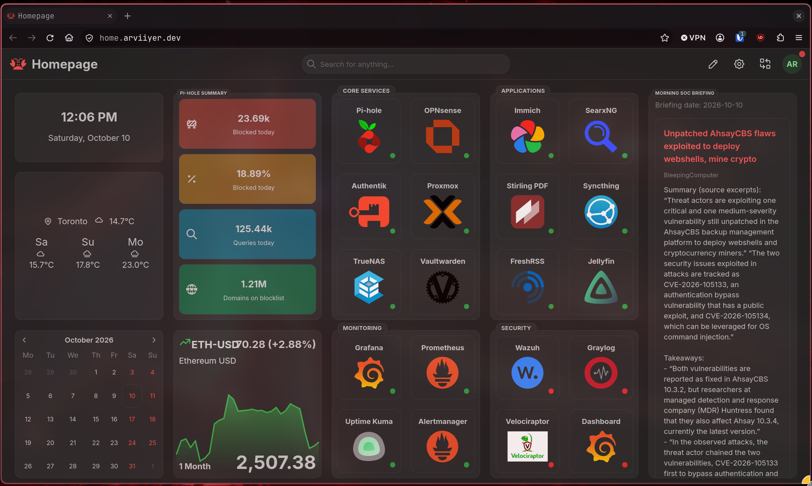

# Homarr

[Home](../../README.md) · [Apps](../README.md) · [FreshRSS](../freshrss/README.md)

Homarr is my starting page for the lab. It brings service links and the
[Morning SOC Briefing](../../projects/reading-brief/README.md) onto one board.
I use its local login, with Caddy providing the private HTTPS route.

[](../../screenshots/README.md#homarr)

- [Install](#install)
- [Add service cards](#add-service-cards)
- [Morning SOC Briefing](#morning-soc-briefing)
- [Backups and restore](#backups-and-restore)
- [Updates](#updates)

## Install

Requirements: Docker Engine, the Compose plugin, curl, and OpenSSL. Download the
[Compose file](compose.yml) into a new directory outside this checkout:

```bash
mkdir -p "$HOME/homelab-examples"
mkdir "$HOME/homelab-examples/homarr"
cd "$HOME/homelab-examples/homarr"
curl --fail --location --output compose.yml \
  https://raw.githubusercontent.com/arviiyer/tamriel-homelab/main/apps/homarr/compose.yml
```

Generate the encryption key once for this new installation. Bash's `noclobber`
option prevents overwriting an existing `.env`:

```bash
(
  set -euC
  umask 077
  key=$(openssl rand -hex 32)
  printf 'SECRET_ENCRYPTION_KEY=%s\n' "$key" > .env
)
docker compose config --quiet
docker compose up -d
docker compose ps
```

Keep this key with your backups. Homarr needs the same key to decrypt saved
integration credentials after a restart, update, or restore.

Open <http://127.0.0.1:7575>. On a remote VM, use
`ssh -L 7575:127.0.0.1:7575 operator@apps-01` first. Choose **Get started**, create
the administrator, and follow onboarding to create a board. Optional integrations
can be added later. Keep the board restricted to your user or group, then check
that a signed-out browser cannot open it.

The example pins Homarr v2.4.1, stores SQLite and configuration in the `appdata`
volume, and uses local credentials. The screenshot is from the lab's v1 setup;
v2's onboarding, layout, and Custom Widget editor differ.

For regular access, use the [private HTTPS guide](../../networking/private-access/README.md).
If Caddy runs on another host, bind the port to the intended private interface
and allow that proxy through the firewall. Keep Homarr's local login enabled.

## Add service cards

1. In **Management → Apps**, add a name, browser URL, and icon for each service.
   Example URLs are `https://photos.example.com`, `https://rss.example.com`, and
   `https://grafana.example.com`.
2. Edit the board, choose **Add board content**, and add App tiles for those apps.
3. Group related cards in Containers, save the layout, and open each link.

App links open in the browser. Integrations and server-side status checks need
URLs reachable from the Homarr container, which may be different from those
browser URLs. A Docker-only hostname will not normally resolve on your laptop.

Service cards do not need Docker access. The Compose example has no Docker socket
mount; add a Docker integration only if you want container discovery or controls.

## Morning SOC Briefing

My reading worker selects articles from FreshRSS and publishes source excerpts
as JSON. Homarr fetches that file every five minutes through a Custom API widget.
The RSS widget in the deployed v1 setup truncated the text, so I switched to
the custom display.

The [reading-brief guide](../../projects/reading-brief/README.md) includes the
worker and feed server. To build a similar display in v2, use a read-only JSON endpoint
that returns this shape (the values here are invented):

```json
{
  "day": "2026-10-10",
  "articles": [
    {
      "id": "example-1",
      "title": "Checking a restore",
      "source": "Example feed",
      "summary": "Restore into a separate directory, then check the files before replacing the original copy.",
      "freshrss_url": "https://rss.example.com/"
    }
  ]
}
```

Under **Management → Custom Widgets**, create a definition in the v2 workbench:

| Setting | Value |
|---|---|
| Name | Morning SOC Briefing |
| HTTP source ID | `default` |
| Source base URL | Your feed server, for example `http://reading-digest-feed:8080` |
| Network scope | `private` for a Docker/private-network feed |
| Authentication | `none` for a feed reachable only on its private Docker network |
| Request ID | `briefing` |
| Request | Load query, `GET /briefing.json` |
| Permission | View |

Both containers must share a Docker network for that example hostname to work.
The lab's feed is private to that network; its port is not published. The basic
Compose file above runs Homarr on its own, so attach your feed before testing
the request. Store any required feed credential in Homarr's source settings.

Use this JSX in the template editor:

```jsx
<ScrollArea h="100%">
  <Stack p="sm" gap="md">
    {status.briefing?.loading && <Text>Loading briefing...</Text>}
    {status.briefing?.error && <Text>Could not load the briefing.</Text>}
    {data.briefing && <Text>Briefing date: {data.briefing.day}</Text>}
    {data.briefing?.articles?.length === 0 && <Text>No articles today.</Text>}
    {(data.briefing?.articles ?? []).map((article) => (
      <Card key={article.id} withBorder p="md">
        <Stack gap="xs">
          <Anchor href={article.freshrss_url} target="_blank" rel="noopener noreferrer">
            {article.title}
          </Anchor>
          <Text size="xs" c="dimmed">{article.source}</Text>
          <Text style={{whiteSpace: 'pre-wrap'}}>{article.summary}</Text>
        </Stack>
      </Card>
    ))}
  </Stack>
</ScrollArea>
```

Run **Test and preview**, check the complete text and article links, and save.
Add a **Custom API** widget to the board, select this definition, and set its
refresh interval to 300 seconds. Keep article content in text bindings rather
than interpreting it as HTML or JSX. The reading worker only publishes JSON;
it does not need a Homarr credential.

## Backups and restore

Back up all of `/appdata`, `compose.yml`, and `.env` together. A board export is
useful for layouts, but does not replace the database and encryption key.

Run this Bash block from the example's directory. It stops Homarr for a consistent
copy and starts it again after the archive succeeds:

```bash
(
  set -eu
  umask 077
  backup=$(mktemp -d "$HOME/homarr-backup.XXXXXX")
  docker compose stop homarr
  docker compose run --rm -T --no-deps --entrypoint tar homarr \
    -C /appdata -czf - . > "$backup/appdata.tar.gz"
  cp compose.yml .env "$backup/"
  docker compose start homarr
  printf 'Backup saved to %s\n' "$backup"
)
```

If copying fails, fix the error before starting Homarr again. Move the backup off
this host with your backup tool. The [Restic guide](../../storage/restic/README.md)
covers copying the archive off-host and restoring into a separate directory.

To test a restore, copy the saved `compose.yml` and `.env` into a new private
directory. Change its loopback port to `127.0.0.1:7576:7575`, and choose a fresh
Compose project name so it creates an empty volume. From that directory:

```bash
read -r -p 'Path to the saved appdata.tar.gz: ' ARCHIVE
docker compose -p homarr-restore run --rm -T --no-deps --entrypoint tar homarr \
  -C /appdata -xzf - < "$ARCHIVE"
docker compose -p homarr-restore up -d
```

At <http://127.0.0.1:7576>, check login, boards, icons, and integration credentials.
Allow any required test-network access before checking live widgets. Remove this
test copy with `docker compose -p homarr-restore down --volumes` when finished.

## Updates

Back up first, read the release notes, and change the image tag and digest
together. The [Renovate guide](../../automation/renovate/README.md) covers opening
and reviewing that change as a pull request.

```bash
docker compose pull
docker compose up -d
docker compose logs --tail=50 homarr
```

Keep `/appdata` and the encryption key unchanged. Check login, layout, service
links, and the reading brief after updating. A v1-to-v2 upgrade migrates SQLite
in place, so rolling back needs the pre-upgrade data backup and its matching
image. Switching only the image back is insufficient. Legacy Custom Widgets
also need migration to v2 definitions in the editor.

## Notes

With Python 3 and Compose 2.24.4 or newer, run this from the repository root:

```bash
python3 scripts/check-service-examples.py --smoke homarr
```

The disposable check starts Homarr, checks onboarding and the SQLite file,
then archives appdata and restores it into a separate project. Interactive board
editing and private service integrations need their own checks in the browser.

- [Docker installation and upgrades](https://homarr.dev/docs/getting-started/installation/docker/)
- [Onboarding](https://homarr.dev/docs/getting-started/after-the-installation/)
- [Custom Widgets](https://homarr.dev/docs/management/custom-widgets/)
- [Requests and network settings](https://homarr.dev/docs/management/custom-widgets/requests-and-security/)
