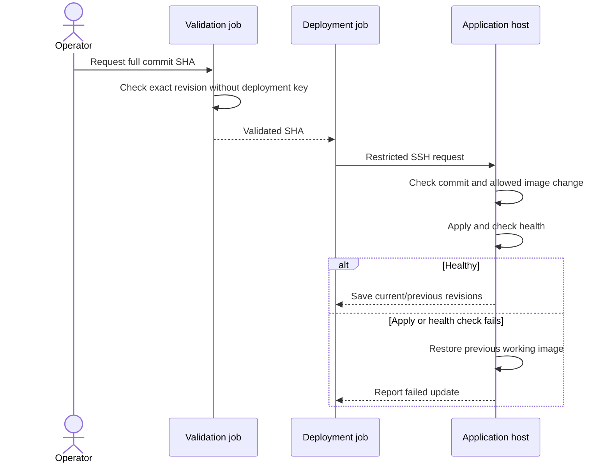

# Deployment and rollback

[Home](../../README.md) · [Automation](../README.md)

I use manually triggered Forgejo workflows for Stirling PDF and Sandbox. The
runner requests a commit; the application host fetches it, applies the update,
and checks health. Most other services are updated manually after CI and merge.

This example implements the SSH request and image rollback for a small API.
The lab's Stirling PDF helper also saves and restores application configuration;
Sandbox handles PostgreSQL backups and migrations. Those data-recovery steps
depend on the application.

## Setup

[`forgejo/promote.yml`](forgejo/promote.yml) accepts deploy or rollback plus a full
SHA from protected `main`. Validation checks out that exact commit without a
deployment key. Its read-only repository token exists only during fetch, before
repository-controlled Compose processing.

The separate deployment job compares the checked SHA with the request and
verifies that it belongs to `main`, without running repository code. The
`promotion` label must select a dedicated, short-lived runner; only the final
request step receives the SSH key.

The example uses `/var/lib/example-deploy`, `/srv/example-api`,
`apps-01.example.com`, and source address `192.0.2.40`. An adapted deployment
needs root-controlled paths, verified host keys, a Git remote and credentials,
and application credentials outside this checkout.

The account-wide SSH policy and
[`authorized_keys` restrictions](target/authorized_keys.example) force requests
through [`restricted_deploy.py`](target/restricted_deploy.py). The per-key source
restriction and narrow sudo rule further limit access. The helper ignores
command-line arguments and reads this exact shape from `SSH_ORIGINAL_COMMAND`:

```text
deploy|rollback example-api <40-character-main-commit>
```

Only a digest-pinned image from `registry.example.com/example-api` may change.
Mounts, devices, capabilities, commands, environment, and extra services cannot
be changed by the request.

## Deploy an update

First run the [disposable-host exercise](#tests) on a suitable test machine. It
creates the initial healthy revision, restricted SSH account, registry, and
target state, then exercises promotion and rollback. The
[setup script](tests/disposable_host_drill.sh) shows that bootstrap sequence.

To adapt the workflow to a private Forgejo repository, configure these pieces
together:

| Setting | Where it belongs |
|---|---|
| Forgejo URL and Compose path | Both fetch steps and the validation command in `promote.yml` |
| `validation` runner label | A runner with Bash, Git, and Compose, without a deployment key |
| `promotion` runner label | A dedicated, short-lived runner with Bash, Git, and OpenSSH |
| `RESTRICTED_DEPLOY_KEY` secret | Private key for the target's restricted `deploy-request` account |
| `DEPLOY_HOST_KEY` variable | Target host-key type and base64 public key, verified through its console |
| Target hostname and runner source address | Workflow SSH command, known-hosts entry, and target key restriction |
| Service, image allowlist, paths, and health URL | Root-owned helper's constants and `DEFAULT_SETTINGS` |

On the target, install Python 3, Git, Docker with Compose, and the root-owned
helper at `/usr/local/sbin/restricted-deploy`. Install the account-wide SSH
policy, restricted authorized key, and sudoers rule from `target/`. Validate
with `sshd -t` and `visudo -c` before reloading SSH. The request account should
not belong to the Docker group.

Initialize the root-controlled bare repository and its protected-main ref, then
start one healthy revision administratively. Its exact Compose file
must be at the configured live path, and the state file must record that commit
as `current` with `previous: null`. Use the
[drill bootstrap](tests/disposable_host_drill.sh) as the worked example. A new
target needs this initial state; the helper does not guess it from running
containers. Keep Git/registry authentication available to the helper's restricted
environment, whose `HOME` is `/var/empty`.

In Forgejo, enable Actions, protect `main`, restrict who can change the workflow
and request a deployment, and install the adapted file under
`.forgejo/workflows/promote.yml`. Then:

1. Review and merge an image-only update, such as a Renovate PR. Record the full
   40-character commit SHA on `main`.
2. Open **Actions → Validate and promote an exact revision → Run workflow**.
   Select `main`, operation `deploy`, and that SHA.
3. Confirm both jobs used that revision. Check the application's health endpoint,
   a normal user operation, and the target's recorded `current` revision.
4. If the health check fails, inspect the job result and verify the old service
   is healthy again. The failed image should not become the recorded current one.
5. To request a later rollback, run the workflow with operation `rollback` and
   the currently deployed SHA. The target chooses its saved previous revision.

Back up the target's configuration, repository, revision state, and application
data together between transactions. Retain image digests in the registry long
enough to pull the saved previous revision. A database migration needs its own
backup and restore procedure before an image rollback is useful.

| Failure | What to inspect |
|---|---|
| Requested commit rejected | Full SHA, protected-main ancestry, and current revision |
| SSH request denied | Runner source address, host key, restricted key, and account policy |
| Image-only check rejected | Compose changes beyond the allowlisted service's image |
| Pending transaction blocks progress | Interrupted transaction and live service state; retain the metadata for recovery |

## Tests

Run from the repository root with Python dependencies from [requirements.txt](requirements.txt).
The SSH/sudo check needs OpenSSH and `visudo`; building the drill image needs Docker:

```bash
python3 -m unittest discover -s automation/ci/tests -p 'test_*.py' -v
bash automation/ci/tests/validate_target.sh
bash automation/ci/tests/run_disposable_host_drill.sh --build-only
```

The Python tests run offline and cover credentials, rejected commands, Git
ancestry, live configuration changes, deployment, rollback, and interrupted
writes. The SSH/sudo check generates and removes its own host key and tests both
allowed and disallowed source addresses.

The full drill requires privileged nested Docker. Run it only on a dedicated
disposable Docker host or isolated daemon after reviewing the harness:

```bash
bash automation/ci/tests/run_disposable_host_drill.sh
```

The launcher builds a temporary target without a default network route. Generated
Git history, a loopback TLS registry, and an SSH endpoint let the drill test real
deployments, rejected requests, failed health checks, rollback, and cleanup.

The full drill takes about a minute for the intentional health failure. The
[integration workflow](../../.github/workflows/integration.yml) builds the image.

## How deployment works



The target stores its own credentials, Compose file, commit history, lock, and
health endpoint. For deployment, it:

1. Takes a nonblocking lock and fetches protected `main` into a root-controlled
   bare repository.
2. Checks that current/requested commits are reachable and the requested commit
   descends from the recorded current revision.
3. Rejects unrecorded edits to the live Compose file and changes beyond the image
   digest.
4. Pulls the image, records a pending transaction, and applies the exact tracked
   Compose definition.
5. Checks the fixed local health endpoint, then saves current/previous revisions.
   Apply or health failure restores the recorded current revision.

File updates use atomic rename and sync the parent directory. If saving the
revision fails before replacement, the helper restores the current definition.
If replacement happened but syncing failed, it keeps the pending record and
reports failure so the next invocation can recover.

For rollback, the request SHA is the expected current revision, not a destination.
The target selects its recorded previous revision. Pending metadata lets a later
invocation restore recorded state after interruption before attempting a change.

## Limits

- Rollback covers one Compose definition and image digest. Database migrations,
  application data, and multi-service orchestration need separate recovery.
- Use a fresh runner for each deployment; cleanup scripts cannot reliably clear
  credentials after a host crash. Repository permissions and secret access also
  need to be configured separately.
