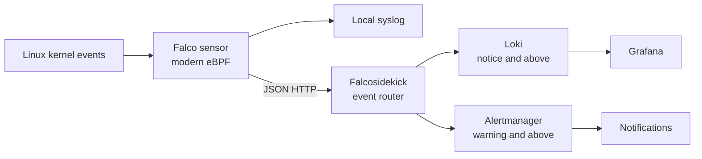

# Falco event routing

Falco events go to Loki for searching and Alertmanager for notifications.

## Routing

| Connection | Configuration |
|---|---|
| Kernel → Falco | Modern eBPF engine on hosts in `falco_sensors` |
| Falco → Falcosidekick | JSON over HTTP; endpoint set in inventory and restricted to sensor hosts |
| Falcosidekick → Loki | Events at `notice` and above, including container details |
| Falcosidekick → Alertmanager | Events at `warning` and above, using the v2 API |

## If delivery fails

Local syslog stays enabled when Falcosidekick is unreachable. Falcosidekick has no
persistent queue, so an outage can lose events. Monitor delivery to Loki and
Alertmanager separately from Falco's process-health check.

File watching is disabled to prevent partial configuration reloads. The
[Ansible role](README.md#deployment-and-rollback) handles configuration checks,
restart, and rollback.

## Test events

[`tests/fixtures/falco-event.json`](tests/fixtures/falco-event.json) and
[`tests/fixtures/falco-notice-event.json`](tests/fixtures/falco-notice-event.json)
contain test events with the JSON fields and priority thresholds used for routing.
