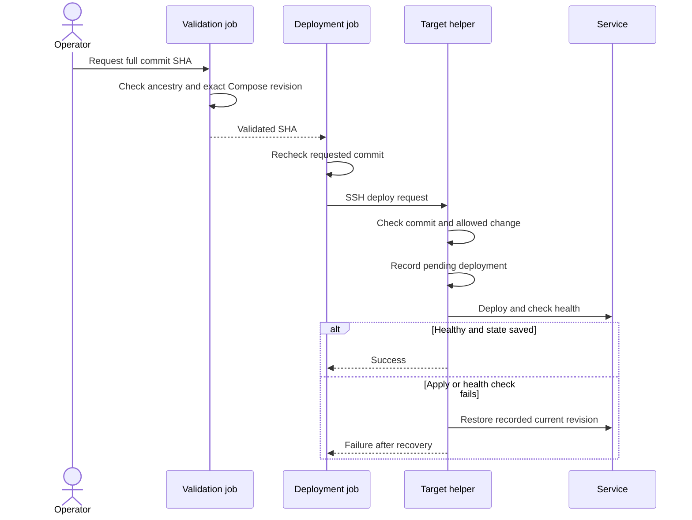

# Deploying the commit that passed CI

[Home](../../README.md) · [Automation](../../automation/README.md) ·
[Deployment setup](../../automation/ci/README.md)

A green CI run is only useful if the deployed commit is the one that passed.
Giving pull-request code a deployment key also gives it a way into the host.

## What I changed

I split validation and deployment into separate jobs. A manual request selects
one full commit SHA from protected `main`. CI checks that exact commit without
deployment credentials. A separate job rechecks the SHA on a fresh runner and
receives an SSH key only for the final request.

That key can call only the target's deployment helper. The helper allows one
image-digest change and checks the commit and live Compose file itself.

## How it works

## Result

The [tests](../../automation/ci/tests) cover rejected requests, deployment,
rollback, and interrupted writes. A [disposable-host drill](../drills/2026-08-24-fail-closed-delivery-rollback.md)
used real SSH and Docker Compose with generated Git history and images. It
deployed A → B, rejected a non-image change, restored B after unhealthy revision
C, and rolled back B → A.

Rollback restores the Compose definition and image. Database migrations and
application data need separate recovery. Interrupted deployments are recorded
so the next invocation can recover before making another change.

[Setup and rollback details](../../automation/ci/README.md)
