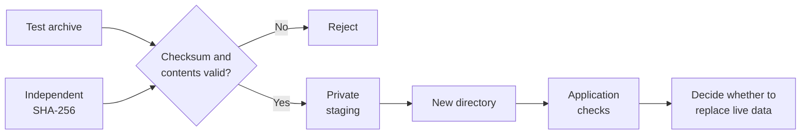

# Restoring Without Overwriting Live Data

A backup might be corrupt or contain the wrong data. Restoring straight over
live files makes either mistake harder to recover from.

## What I changed

I built an offline restore example using generated archives. It checks an
independently supplied SHA-256, the declared dataset, and every file's path,
size, and checksum before writing anything. Links and special files are rejected.

Files go into a temporary directory first. Only a complete restore is moved to
the requested destination, which must be new. Checking the application and
replacing live data are separate manual steps.

## How it works

## Waiting for the right storage

A missing network mount leaves an empty local directory that a service might
start writing into. The accompanying systemd example checks for the expected
read-write mount and a dataset marker before startup. It uses a placeholder
workload command; testing it with missing or incorrect mounts is on the
[roadmap](../../ROADMAP.md).

## Result

The [restore drill](../../evidence/drills/2026-08-24-isolated-synthetic-restore.md)
restored exact test files and permissions. It rejected corruption, unsafe paths,
links, and the wrong dataset. An injected write failure left no partial
destination. The [unit tests](../../automation/recovery/tests) cover archive
checks, filesystem failures, and the systemd configuration.

[Implementation, archive format, and commands](../../automation/recovery/README.md)
