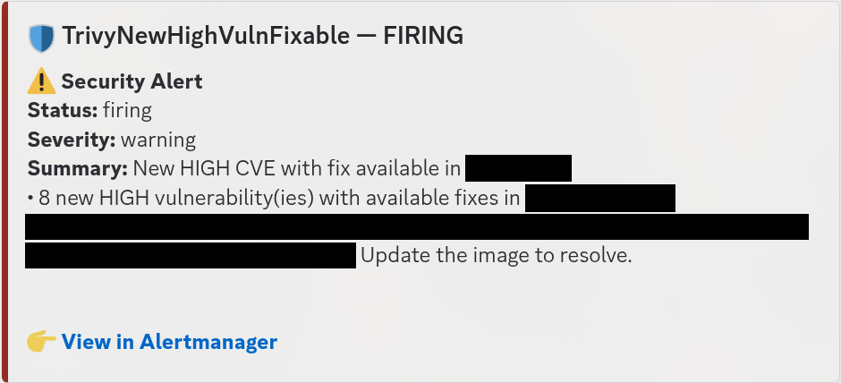

# Screenshots

Four captures from the lab. Click an image to open it at full resolution.

## Trivy dashboard

[](grafana-security-dashboard.png)

*Vulnerability totals, new critical findings, and new high-severity findings with fixes.*

The dashboard's secret status comes from [Trivy file scans](../../automation/trivy/README.md#secret-scans).
Git-history scans run separately.

[Redaction and review details](grafana-security-dashboard.review.md)

## Forgejo CI

[](forgejo-validation-run.png)

*Compose checks passing on a dependency-update pull request.*

[Redaction and review details](forgejo-validation-run.review.md)

## Discord alert

[](security-scan-alert.png)

*Trivy alert delivered to Discord for eight new high-severity findings with available fixes.*

[Redaction and review details](security-scan-alert.review.md)

## Proxmox cluster

[](proxmox-cluster-summary.png)

*Proxmox cluster health showing three nodes online and quorum established.*

[Redaction and review details](proxmox-cluster-summary.review.md)

<details>
<summary>Adding screenshots</summary>

### Adding an image

This directory accepts only final, reviewed screenshots. Original captures and
working redaction files stay outside the repository. Follow the
[screenshot checklist](../../docs/publication-policy.md#screenshot-review).

The deny-by-default `.gitignore` requires each image and its same-name `.review.md`
record to be force-added after review. For example:

```text
grafana-security-dashboard.png
grafana-security-dashboard.review.md
```

### Review record template

```markdown
# Screenshot Review: <title>

- Capture month: YYYY-MM
- What it shows: <feature or result>
- Source: Real operated environment / synthetic fixture
- Cropped to minimum evidence: Yes
- Opaque redactions applied: Yes
- Browser URL removed: Yes / Not present
- Hostnames and addresses removed: Yes
- Usernames, emails, and IDs removed: Yes
- Hashes, tokens, and fingerprints removed: Yes
- Owner-approved retained values: None / <specific values and rationale>
- Metadata stripped: Yes
- OCR output reviewed: Yes
- Second reviewer: <name or handle>
- Notes: <what remains visible and why it is safe>
```

### What to capture

Capture only the area described below. Browser chrome, navigation,
sidebars, notifications, and unrelated rows should remain outside the capture
rather than being redacted afterward.

| Filename | What to show | What to crop or redact |
|---|---|---|
| `grafana-security-dashboard.png` | Severity totals and new critical/fixable HIGH findings; original Last Scan timestamp retained with owner approval | Surrounding tables, navigation, repository/image references, and user identity |
| `forgejo-validation-run.png` | Workflow and job names, successful checkout and Compose-validation steps; not proof of required-check enforcement | Repository and organization names, actor identity, commit hash, pull-request number, image/version details, and surrounding navigation |
| `security-scan-alert.png` | One delivered notification showing severity, new fixable findings, firing status, and an update instruction; not proof of scan completeness or remediation | Repository, image reference/version/digest, sender header, and message timestamp |
| `proxmox-cluster-summary.png` | Cluster health, quorum state, and aggregate online/offline node counts; project-aligned cluster name retained with owner approval | Node tree, addresses, VM or storage IDs, guest names, account header, task history, exact versions, and resource totals |

Public CVE identifiers and generic product labels may remain visible. Opaque
redaction must fully cover each private value; do not replace real labels with
fabricated labels inside the image.

</details>
