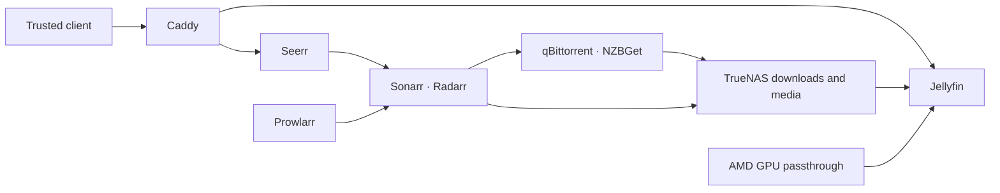
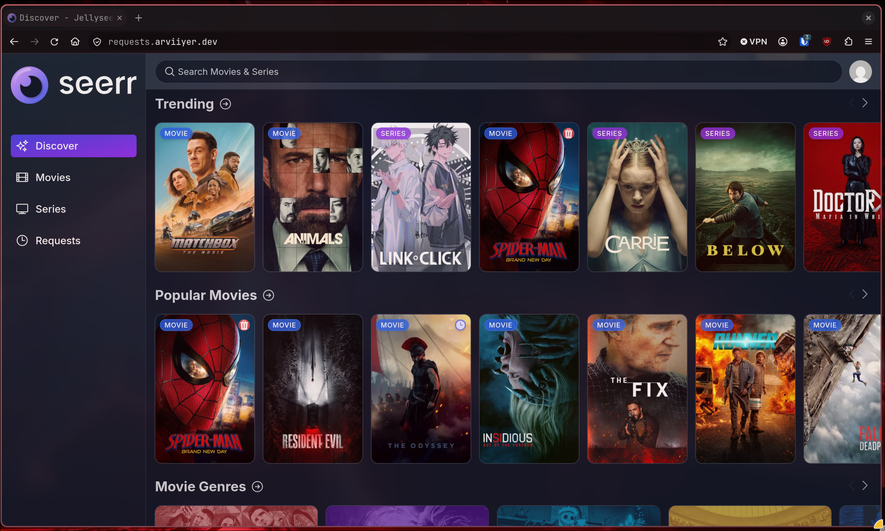

# Media

[Home](../README.md) · [Apps](../apps/README.md) · [Storage](../storage/README.md)

Jellyfin plays the media library, Seerr handles requests, and the Servarr stack
manages downloads and library organization. They run in a Debian VM on the ROG
Ally, with its AMD GPU passed through for transcoding.

To build a similar setup:

1. Prepare a [Debian Docker VM](../proxmox/debian-vm/README.md) and its
   [NAS mounts](../storage/nfs/README.md).
2. Install [Jellyfin](jellyfin/README.md) and check playback from the library.
3. Add [requests, downloads, and Gluetun](servarr/README.md), then connect Seerr
   to Jellyfin.
4. Configure [private HTTPS](../networking/private-access/README.md) for the
   browser and media clients.

## The setup

Jellyfin and Seerr use private HTTPS routes. Local DNS points at the proxy at
home, and remote clients use Tailscale. The former public media ingress has been
retired. See [networking](../networking/README.md#dns).

## Jellyfin and the GPU

The ROG Ally's integrated AMD GPU is passed from Proxmox to the media VM. The
guest loads the AMD driver and firmware, and the Jellyfin container receives
the render device. VA-API handles hardware transcoding.

The [Jellyfin guide](jellyfin/README.md) walks through installation, GPU
passthrough, render-device permissions, and a forced-transcoding check. It also
covers private access, sign-in, and updates.

Jellyfin mounts the media library read-only. Library deletion goes through the
media managers, followed by a Jellyfin library scan. Sign-in uses the Authentik
SSO plugin.

## Requests and downloads

Seerr sends requests to Sonarr and Radarr. Prowlarr manages indexers, qBittorrent
handles torrents, and NZBGet handles Usenet. Lidarr and Readarr handle music and
books, respectively. Readarr is still installed, although its upstream project
has retired. See the [app catalogue](../apps/README.md#media-and-games).
FlareSolverr supplies the browser helper used by some indexer requests.

The [download-stack walkthrough](servarr/README.md) includes Compose files,
directory permissions, VPN setup, and the addresses and settings used to connect
these applications.

The [Discord approver](../projects/seerr-discord-approver/README.md) adds
request actions to Discord. It rechecks the request in Seerr before applying an
action and keeps its webhook inside the media stack.

## VPN and health checks

The download and Servarr services share Gluetun's network namespace. Gluetun
connects through Mullvad WireGuard. This connection has no VPN port forwarding.

Application health checks probe their local HTTP endpoints. Gluetun's own check
tests the VPN path. That avoids treating a shared DNS failure as a separate
application failure in every container. deunhealth restarts selected unhealthy
containers, and a startup unit reconciles the stack after Docker and storage
are ready.

The namespace arrangement also matters during updates: recreating Gluetun can
require recreating its dependents so they join the current namespace.

[Gluetun documentation](https://github.com/qdm12/gluetun-wiki)

## Storage and backups

Downloads and media use separate NAS exports. The applications see consistent
download and library paths, but separate exports prevent hardlinks between them.
Imports across that boundary copy data. A shared directory layout alone does
not make separate filesystems support hardlinks.

Application databases and configuration stay on the VM. PBS covers those local
disks; the NAS files need their own backup plan. Before upgrades that migrate
SQLite databases, retain a matching configuration/database backup and the old
image reference.

ClamAV scans downloaded files, with results sent to the monitoring stack. See
[security](../security/README.md#crowdsec-and-clamav) and
[storage startup ordering](../storage/README.md#waiting-for-shared-storage).

## Notes

- [Jellyfin documentation](https://jellyfin.org/docs/)
- [Seerr documentation](https://docs.seerr.dev/)
- [Servarr storage guide](https://wiki.servarr.com/docker-guide)
- [Host monitoring example](../monitoring/host-metrics/README.md)
