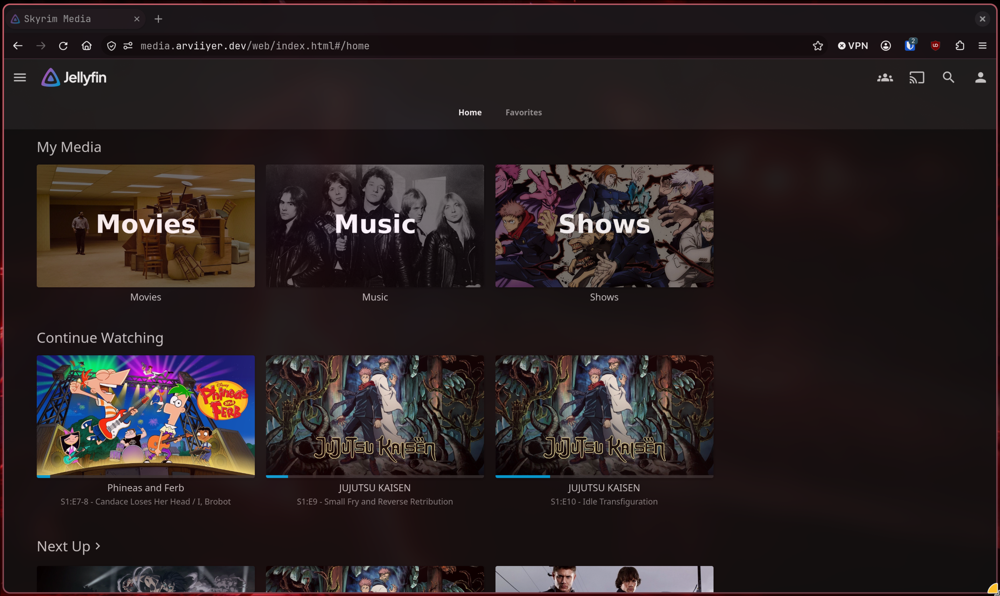

# Jellyfin

[Home](../../README.md) · [Media](../README.md) · [Storage](../../storage/README.md)

Jellyfin plays my media library. It runs in a Debian VM on the ROG Ally, with the
AMD GPU passed through for transcoding. The library is mounted read-only from
TrueNAS; Jellyfin's database, metadata, and cache stay on the VM.

[](../../screenshots/README.md#jellyfin)

- [Install](#install)
- [Pass the GPU to the VM](#pass-the-gpu-to-the-vm)
- [Enable hardware transcoding](#enable-hardware-transcoding)
- [Access and sign-in](#access-and-sign-in)
- [Backups and updates](#backups-and-updates)
- [Troubleshooting](#troubleshooting)

## Install

Requirements: a Linux host with Docker Engine, the Compose plugin, Bash, and curl.
The initial example works without a GPU. Download the [Compose file](compose.yml)
into a new directory outside this checkout and prepare the data directories:

```bash
mkdir -p "$HOME/homelab-examples"
mkdir "$HOME/homelab-examples/jellyfin"
cd "$HOME/homelab-examples/jellyfin"
curl --fail --location --output compose.yml \
  https://raw.githubusercontent.com/arviiyer/tamriel-homelab/main/media/jellyfin/compose.yml
mkdir config cache media
printf 'JELLYFIN_UID=%s\nJELLYFIN_GID=%s\n' "$(id -u)" "$(id -g)" > .env
```

The container runs as your host user, stores application data in those
directories, and publishes the web interface on localhost.

Copy a small test video into `media`, then start Jellyfin:

```bash
docker compose config --quiet
docker compose up -d
docker compose ps
curl --fail http://127.0.0.1:8096/health
```

Once startup finishes, the health endpoint should return `Healthy`. Open
<http://127.0.0.1:8096>, create an administrator, and add `/media` as a library.
Wait for the scan and try playback. This example uses a direct server URL rather
than publishing discovery ports.

For a remote VM, use `ssh -L 8096:127.0.0.1:8096 operator@media-01` to reach the
wizard. To use NAS storage, change the bind mount's `source` to your mounted
library. The container user needs read and directory-traversal permission on it.
The lab's [mount checks](../../storage/README.md#waiting-for-shared-storage) run
before Docker starts.

## Pass the GPU to the VM

For Proxmox, follow the [PCI passthrough guide](https://pve.proxmox.com/wiki/PCI_Passthrough)
for your hardware and bootloader:

1. Enable virtualization and IOMMU support in the firmware and host configuration.
2. Check the GPU's IOMMU group and arrange for VFIO to own the device on the host.
3. With the VM stopped, add the GPU as a PCI device in its hardware settings.
4. Boot Debian with a kernel and AMD firmware that support the GPU. On Debian,
   `firmware-amd-graphics` comes from the `non-free-firmware` component.

Inside the VM, check:

```bash
lspci -nnk
ls -l /dev/dri
```

The GPU should use `amdgpu` in the guest and expose a render device such as
`/dev/dri/renderD128`. If that device is missing, fix the guest driver or
passthrough first. Container settings cannot supply a GPU the guest cannot see.

On the Ally, I also turn off the built-in display after the guest initializes
the GPU. Its integrated graphics share system memory, so the VM's RAM allocation
and the firmware's GPU reservation both matter.

## Enable hardware transcoding

Use the render device found above. On the Docker host (the Debian VM in this
setup), record its owning group:

```bash
stat -c '%n group=%g permissions=%a' /dev/dri/renderD128
printf 'RENDER_GID=%s\n' "$(stat -c '%g' /dev/dri/renderD128)" >> .env
```

The numeric group comes from your host. Download the
[GPU override](gpu.override.yml), adjusting its device path if needed:

```bash
curl --fail --location --output gpu.override.yml \
  https://raw.githubusercontent.com/arviiyer/tamriel-homelab/main/media/jellyfin/gpu.override.yml
```

Recreate Jellyfin and check VA-API from inside the container:

```bash
docker compose -f compose.yml -f gpu.override.yml config --quiet
docker compose -f compose.yml -f gpu.override.yml up -d
docker compose -f compose.yml -f gpu.override.yml exec jellyfin \
  /usr/lib/jellyfin-ffmpeg/vainfo --display drm --device /dev/dri/renderD128
```

Keep both `-f` arguments on subsequent Compose commands for this GPU setup.
The official image supplies the userspace Mesa drivers. `vainfo` should list
the GPU's supported profiles, rather than a permission or driver error.

In **Dashboard → Playback → Transcoding**, select **VA-API**, set the render
device, and enable only the codecs supported by the `vainfo` output. Follow the
[AMD guide](https://jellyfin.org/docs/general/post-install/transcoding/hardware-acceleration/amd/)
for tone-mapping and codec-specific settings.

Play a video and lower the playback resolution or bitrate enough to require
video transcoding. Check the session's playback information and FFmpeg log for
VA-API decoding/encoding. Direct play and audio-only conversion do not test the
video encoder.

## Access and sign-in

The lab uses private Caddy routes with local DNS at home and Tailscale when away.
For a hostname such as `https://media.example.com`, configure the proxy to reach
Jellyfin's HTTP port and forward WebSocket connections. A proxy on a separate
host needs an explicitly reachable private port; the example's loopback binding
only accepts connections on its own host.

Set Jellyfin's known proxies to the proxy you actually use. See the
[Jellyfin networking guide](https://jellyfin.org/docs/general/post-install/networking/)
and the [lab's access layout](../../networking/README.md#caddy-and-authentik).
The [private HTTPS guide](../../networking/private-access/README.md) includes the
DNS and certificate setup. Use Jellyfin's own authentication on its route.

I use the [SSO plugin](https://github.com/9p4/jellyfin-plugin-sso) with Authentik
for browser sign-in. Configure the provider and exact callback from the plugin's
instructions, and keep issuer and endpoint validation enabled. Check the login
method supported by each TV or phone client separately.

Seerr and the download applications have their own
[media-stack notes](../README.md#requests-and-downloads).

## Backups and updates

Back up `config` while Jellyfin is stopped, along with the Compose files, local
environment settings, and the image reference. It contains the database, users,
metadata, and plugin settings. The cache can be rebuilt. The media library needs
its own backup, as described under [Storage](../../storage/README.md#backups).

After reading the release notes and taking a backup, replace the image digest
with the chosen release's digest and recreate the container. For the GPU setup:

```bash
docker compose -f compose.yml -f gpu.override.yml pull
docker compose -f compose.yml -f gpu.override.yml up -d
docker compose -f compose.yml -f gpu.override.yml logs --tail=50 jellyfin
```

Check login, library scanning, direct play, and a forced transcode. A release
that migrates the database may need its matching data backup for rollback.

To test a restore, use a separate configuration directory, project name, and
loopback port, with a small copied media sample. Check user accounts, library
paths, and playback before connecting it to a larger library.

## Troubleshooting

| Symptom | First thing to check |
|---|---|
| No render device in the VM | PCI assignment, guest kernel, AMD firmware, and driver |
| `vainfo` reports permission denied | Numeric render group, device mapping, and container recreation |
| Library looks empty | NAS mount, container path, and the container user's read permissions |
| Playback works but uses the CPU | Session is actually transcoding, VA-API is selected, and the codec is supported |
| Playback fails after enabling acceleration | FFmpeg log and the profile list from `vainfo` |
| Configuration cannot be written | Ownership of `config` and `cache` matches the configured user |

## Checks

With Python 3 and Compose 2.24.4 or newer, run from the repository root:

```bash
python3 scripts/check-service-examples.py --validate
python3 scripts/check-service-examples.py --smoke jellyfin
```

The smoke test checks startup, writable application directories, and read-only
access to a generated video. The GPU override is checked as configuration;
transcoding needs the [hardware check](#enable-hardware-transcoding) on your host.

[Official container setup](https://jellyfin.org/docs/general/installation/container/) ·
[Jellyfin backup guide](https://jellyfin.org/docs/general/administration/backup-and-restore/)
