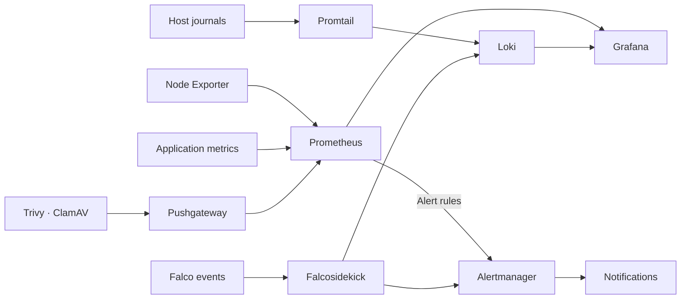

# Monitoring

[Home](../README.md) · [Apps and services](../apps/README.md) ·
[Security](../security/README.md)

I use Prometheus for metrics, Loki for logs, Grafana for dashboards, and
Alertmanager for notifications. Uptime Kuma checks service reachability. Host
metrics, application metrics, scan results, and runtime events feed these tools.

Start with [host metrics and alerts](host-metrics/README.md), then add
[host logs](logs/README.md) and [Uptime Kuma](uptime-kuma/README.md) checks for the
applications you care about.

The [UPS guide](ups/README.md) covers power monitoring and host shutdown with NUT.

## Grafana

This is [Node Exporter Full, dashboard 1860](https://grafana.com/grafana/dashboards/1860-node-exporter-full/)
on the Raspberry Pi. I use it to view CPU, memory, network traffic, and disk use
over time. The [metrics guide](host-metrics/README.md#add-other-hosts) covers
importing it and adding hosts.

### Security scans

The Trivy dashboard groups findings by image and repository. To build a similar
view, [load the security dashboard](security-dashboard/README.md) and connect
Trivy metrics and Falco logs.

The wider lab also has dashboards for host CPU, memory, disks, and uptime;
Immich jobs; Forgejo activity; Falco events; and Prometheus/Alertmanager health.
A general overview helps find the affected host before opening a service-specific
dashboard.

## Metrics, logs, and alerts

| Tool | What I use it for |
|---|---|
| Prometheus | Host capacity, application metrics, scan results, and target health |
| Loki | Host journals, firewall syslog, and Falco events |
| Grafana | Host and application dashboards, log searches, and security findings |
| Alertmanager | Host-capacity warnings, scanner failures, findings, and Falco notifications |

Node Exporter supplies operating-system metrics from the hosts and VMs. Immich,
Forgejo, and CrowdSec also expose their own metrics. Pushgateway holds results
from batch scans so Prometheus can scrape them between runs. A stored result
still needs a timestamp or health metric to tell whether it is stale.

The documented host log shipper is Promtail, sending journal logs to Loki.
Falcosidekick sends structured Falco events directly to Loki and Alertmanager.
Promtail is now end-of-life; the [new log-collection guide](logs/README.md) uses
Alloy, with migration of the existing hosts tracked on the roadmap.

## Uptime Kuma

Kuma checks hosts and application endpoints separately from Prometheus metrics.
When the monitoring VM's Tailscale key expired, private HTTPS checks failed while
LAN Prometheus targets stayed healthy. That distinction made the access path
important to check alongside the applications. The
[Kuma guide](uptime-kuma/README.md) covers choosing endpoints and notifications.

Standalone monitors notify directly. Display-only groups stay quiet, while the
Servarr group sends one aggregate notification rather than one per dependent
application when the media host becomes unavailable.

## Notifications

An alert for eight new high-severity findings with fixes available. The
[alerting notes](../docs/trivy-alerts.md)
explain which changes trigger a notification.

General infrastructure notifications and security findings use separate Discord
routes. Critical security events also have an email route. Host-memory warnings
use a recovery window to reduce repeated warning/recovery messages during short
fluctuations.

## Notes

- [Security dashboard configuration](security-dashboard/README.md)
- [Trivy metrics and alert rules](../automation/trivy/README.md#metrics-and-alerts)
- [Falco event routing](../automation/falco/event-flow.md)
- [Grafana documentation](https://grafana.com/docs/grafana/latest/)
- [Prometheus documentation](https://prometheus.io/docs/introduction/overview/)
- [Loki documentation](https://grafana.com/docs/loki/latest/)
- [Alertmanager documentation](https://prometheus.io/docs/alerting/latest/alertmanager/)
