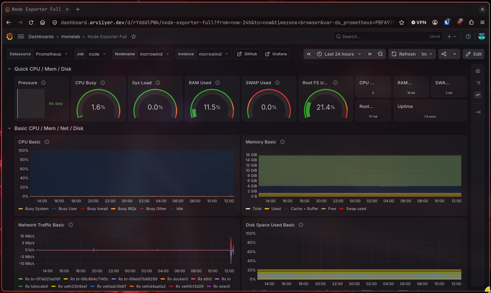
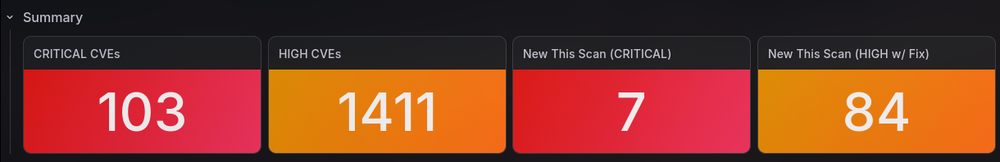
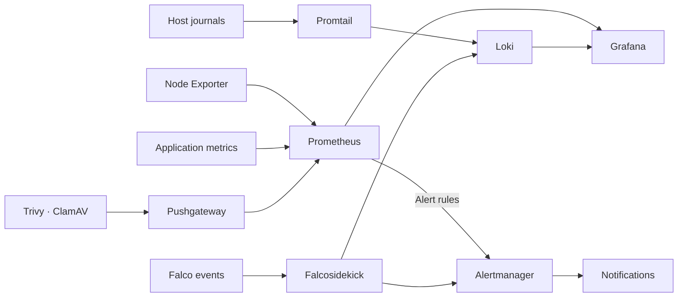

# Monitoring

[Home](../README.md) · [Apps and services](../apps/README.md) ·
[Security](../security/README.md)

I use Prometheus for metrics, Loki for logs, Grafana for dashboards, and
Alertmanager for notifications. Uptime Kuma checks service reachability. Host
metrics, application metrics, scan results, and runtime events feed these tools.

Setup guides: [Host metrics and alerts](host-metrics/README.md) ·
[Host logs](logs/README.md) · [Uptime Kuma](uptime-kuma/README.md)

## Grafana

The Node Exporter dashboard gives me a view of host CPU, memory, network traffic,
and disk usage over time.

### Security scans

The Trivy dashboard shows vulnerability totals and new findings. The secret
panel reports file scans; Git-history scans run separately. The
[public dashboard example](../automation/monitoring/README.md) also includes
scanner health and Falco events.

The wider lab also has dashboards for host CPU, memory, disks, and uptime;
Immich jobs; Forgejo activity; Falco events; and Prometheus/Alertmanager health.
A general overview helps find the affected host before opening a service-specific
dashboard.

For a small starting point, the [host-metrics example](host-metrics/README.md)
connects Node Exporter, Prometheus, and a provisioned Grafana dashboard.

## Metrics, logs, and alerts

| Tool | What I use it for |
|---|---|
| Prometheus | Scan attempts, successful scans, finding totals, and new findings |
| Loki | Falco events with source, priority, host, and rule labels |
| Grafana | Finding totals, scanner health, and runtime events |
| Alertmanager | Finding alerts, scanner failures, stale scans, and routed Falco events |

Node Exporter supplies operating-system metrics from the hosts and VMs. Immich,
Forgejo, and CrowdSec also expose their own metrics. Pushgateway holds results
from batch scans so Prometheus can scrape them between runs. A stored result
still needs a timestamp or health metric to tell whether it is stale.

The documented host log shipper is Promtail, sending journal logs to Loki.
Falcosidekick sends structured Falco events directly to Loki and Alertmanager.
Promtail is now end-of-life; the [new log-collection guide](logs/README.md) uses
Alloy, with migration of the existing hosts tracked on the roadmap.

## Uptime Kuma

Kuma checks hosts and application endpoints separately from Prometheus metrics.
A working host scrape does not prove that DNS, HTTPS, and application sign-in
work from the client path.

Standalone monitors notify directly. Display-only groups stay quiet, while the
Servarr group sends one aggregate notification rather than one per dependent
application when the media host becomes unavailable.

The [Trivy metrics guide](../automation/trivy/README.md#metrics-and-alerts)
lists the exported metrics and alert rules. The
[Falco routing guide](../automation/falco/event-flow.md) explains event priorities
and delivery behavior.

## Notifications

An alert for eight new high-severity findings with fixes available. The
[alerting notes](../docs/case-studies/actionable-vulnerability-management.md)
explain which changes trigger a notification.

General infrastructure notifications and security findings use separate Discord
routes. Critical security events also have an email route. Host-memory warnings
use a recovery window to reduce repeated warning/recovery messages during short
fluctuations.

## Notes

- [Security dashboard configuration](../automation/monitoring/README.md)
- [Grafana documentation](https://grafana.com/docs/grafana/latest/)
- [Prometheus documentation](https://prometheus.io/docs/introduction/overview/)
- [Loki documentation](https://grafana.com/docs/loki/latest/)
- [Alertmanager documentation](https://prometheus.io/docs/alerting/latest/alertmanager/)
