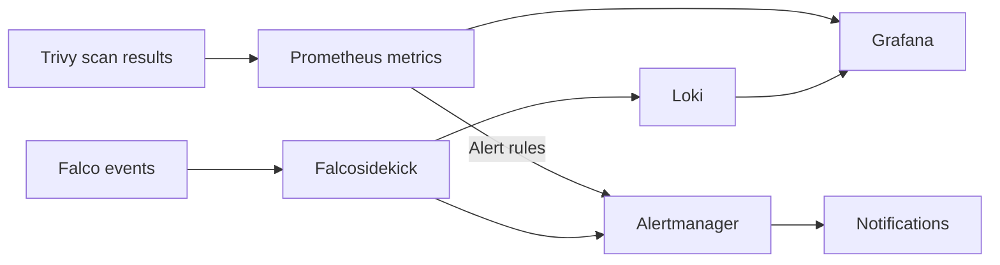

# Monitoring

[Home](../README.md) · [Apps and services](../apps/README.md) ·
[Security](../security/README.md)

I use Prometheus for metrics, Loki for logs, Grafana for dashboards, and
Alertmanager for notifications. Scan results and runtime events feed into
those tools alongside the lab's monitoring.

## Grafana

The Trivy dashboard shows vulnerability totals and new findings. The secret
panel reports file scans; Git-history scans run separately. The
[public dashboard example](../automation/monitoring/README.md) also includes
scanner health and Falco events.

The example loads its dashboard and datasources from files. Its setup guide
links to the JSON and provisioning configuration and explains the datasource
UIDs and Loki labels used by the panels.

## Metrics, logs, and alerts

| Tool | What to look at in the examples |
|---|---|
| Prometheus | Scan attempts, successful scans, finding totals, and new findings |
| Loki | Falco events with source, priority, host, and rule labels |
| Grafana | Finding totals, scanner health, and runtime events |
| Alertmanager | Finding alerts, scanner failures, stale scans, and routed Falco events |

The [Trivy metrics guide](../automation/trivy/README.md#metrics-and-alerts)
lists the exported metrics and alert rules. The
[Falco routing guide](../automation/falco/event-flow.md) explains event priorities
and delivery behavior.

## Notifications

An alert for eight new high-severity findings with fixes available. The
[alerting notes](../docs/case-studies/actionable-vulnerability-management.md)
explain which changes trigger a notification.

## Checking the dashboard

The dashboard example distinguishes a successful scan with zero findings from
missing health data. Its tests check dashboard structure, one failure-count
query against generated Prometheus data, and Grafana loading through its API.

[Setup and test commands](../automation/monitoring/README.md) ·
[Remaining query tests](../ROADMAP.md#lab-and-automation)

## Notes

- [Grafana documentation](https://grafana.com/docs/grafana/latest/)
- [Prometheus documentation](https://prometheus.io/docs/introduction/overview/)
- [Loki documentation](https://grafana.com/docs/loki/latest/)
- [Alertmanager documentation](https://prometheus.io/docs/alerting/latest/alertmanager/)
