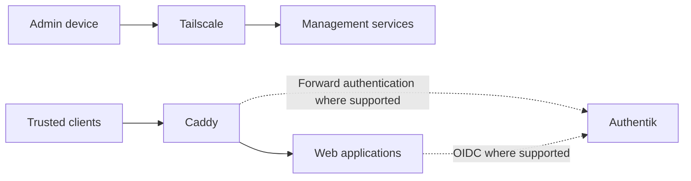

# Networking

[Home](../README.md) · [Apps and services](../apps/README.md) ·
[Security](../security/README.md)

OPNsense handles routing and firewall rules. I use Tailscale for administration,
Caddy for web applications, and Authentik for sign-in where supported.

## OPNsense and the network

The ThinkCentre M720q runs OPNsense with an Intel i350-T4 NIC. A Ubiquiti
USW-Lite-16-PoE switch and U6-Plus access point provide wired and wireless
connections. The Raspberry Pi supplies DNS and the reverse proxy.

The network separates infrastructure, trusted clients, work devices, guests,
media, and sandbox workloads. Connections between zones are allowed for specific
needs. The [network-zone table](../docs/network-and-identity.md#network-zones)
lists the roles and restrictions.

## Access paths

## Tailscale

Tailscale gives me private access to administration interfaces. Hypervisor,
gateway, and storage management stay off the public internet. Each management
service still requires its own login.

This makes administration depend on Tailscale and trusted devices. The
[access notes](../docs/network-and-identity.md#when-something-fails) describe the
expected behavior when a dependency fails.

## Caddy and Authentik

Trusted clients reach web applications through Caddy. Authentik supplies OIDC
or forward authentication where supported; applications retain their own
permissions and use their own login when an integration is unavailable.

DNS resolution, routing, proxying, and application sign-in are separate parts
of this path. A working hostname alone does not establish that a client can
reach a service or is allowed to use it.

## Notes

- [Network zones and allowed connections](../docs/network-and-identity.md)
- [SSH configuration example](../automation/ansible/README.md)
- [OPNsense documentation](https://docs.opnsense.org/)
- [Tailscale documentation](https://tailscale.com/kb)
- [Caddy documentation](https://caddyserver.com/docs/)
- [Authentik documentation](https://docs.goauthentik.io/)
