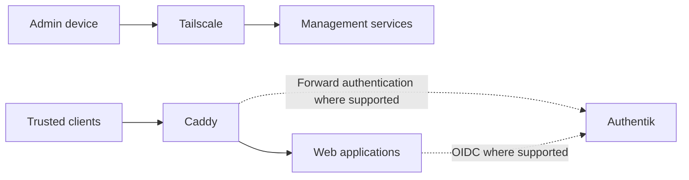

# Networking

[Home](../README.md) · [Apps and services](../apps/README.md) ·
[Security](../security/README.md)

OPNsense handles routing and firewall rules. I use Tailscale for administration,
Caddy for web applications, and Authentik for sign-in where supported.

Setup guides: [Pi-hole and Unbound](dns/README.md) ·
[Private HTTPS with Caddy, Tailscale, and Authentik](private-access/README.md)

## OPNsense and the network

The ThinkCentre M720q runs OPNsense with an Intel i350-T4 NIC. A Ubiquiti
USW-Lite-16-PoE switch and U6-Plus access point provide wired and wireless
connections, managed through UniFi Network in its own VM. The Raspberry Pi
supplies DNS and the reverse proxy.

The infrastructure machines still share the original LAN. The separate client
VLANs and media segment are in use; splitting management and ordinary servers
into their own VLANs remains future work. The
[network migration notes](../docs/network-migration.md) explain what went wrong
with the first attempt and why I narrowed the next change.

## Network zones

Management is an access role within the infrastructure LAN, rather than a
separate VLAN. Connections between routed zones are blocked unless explicitly
allowed.

| Zone or role | Use | Access |
|---|---|---|
| Management | Infrastructure administration | Tailscale and a login for each service |
| Infrastructure | Hypervisors, storage, identity, and DNS | Specific connections from clients and workloads |
| Trusted clients | Personal devices | Private apps through Caddy |
| Managed work | Business use and external services | No personal infrastructure or data |
| Untrusted devices | Restricted devices | DNS and internet access |
| Guest | Visitors | Internet access |
| Media | Playback and downloads | Required apps, storage shares, DNS, and external services |
| Sandbox | Analysis worker | Separate administration and limited outbound access; no trusted-zone access |

Services have access to their required identity, DNS, and storage dependencies.
Monitoring collects metrics and logs. Deployment requests go through the
[restricted SSH helper](../automation/ci/README.md). Work, untrusted, and guest
zones cannot reach private zones; the sandbox worker cannot reach trusted or
infrastructure zones.

## DNS

Client DNS goes through Pi-hole, with Unbound on the Pi resolving upstream
queries. OPNsense supplies the client DNS settings and enforces the allowed DNS
path for restricted device networks.

Selected private application names use split DNS. At home, Pi-hole answers with
the proxy's LAN address. Public DNS returns the proxy's Tailscale address, so
remote clients still need the private network. Both answers lead to Caddy with
the same hostname and certificate. FreshRSS, Jellyfin, and Seerr use this pattern.

Cloudflare hosts the public DNS records. Ordinary Caddy-backed apps use DNS-only
records. Minecraft has a separate Cloudflare Tunnel, and the sandbox has a
fixed-response Cloudflare Worker used for URL testing. The Worker has no route
back into the lab.

## Access paths

## Tailscale

Tailscale gives me remote access to private apps and administration interfaces.
Hypervisor, gateway, and storage management stay off the public internet. Each management
service still requires its own login.

## Caddy and Authentik

Trusted clients reach web applications through Caddy. Authentik supplies OIDC
or forward authentication where supported; applications retain their own
permissions and use their own login when an integration is unavailable.

| Application | Sign-in |
|---|---|
| Grafana, Immich, Forgejo | Authentik OAuth2/OIDC |
| FreshRSS | Authentik OIDC through `mod_auth_openidc` |
| Jellyfin | Authentik through the SSO plugin |
| Uptime Kuma | Authentik proxy outpost |
| Forge VM portal | Authentik forward authentication |
| Sandbox UI | Application-enforced Authentik OIDC |
| Homarr, Stirling PDF | Local application login |

The [FreshRSS notes](../apps/freshrss/README.md#sign-in) cover its callback and
username mapping. These integrations are configured per application; adding a
Caddy route does not automatically add Authentik.

The [private-access guide](private-access/README.md) connects Caddy on the Pi to
Authentik and application VMs, including DNS, certificates, and media routes.

## Try a reverse proxy

The [Caddy example](caddy/README.md) runs a proxy and a tiny upstream on an
isolated Docker network. It demonstrates hostname routing on localhost before
adding real DNS, TLS, or an identity provider.

## Notes

The [DNS](dns/README.md#checks) and [browser sign-in](private-access/README.md#checks)
guides include isolated checks, including sign-in failure when Authentik is
unavailable. Routed VLAN and tailnet client tests are on the [roadmap](../ROADMAP.md).

- [SSH configuration example](../automation/ansible/README.md)
- [OPNsense documentation](https://docs.opnsense.org/)
- [Tailscale documentation](https://tailscale.com/kb)
- [Caddy documentation](https://caddyserver.com/docs/)
- [Authentik documentation](https://docs.goauthentik.io/)
- [Pi-hole documentation](https://docs.pi-hole.net/)
- [Unbound documentation](https://unbound.docs.nlnetlabs.nl/)
