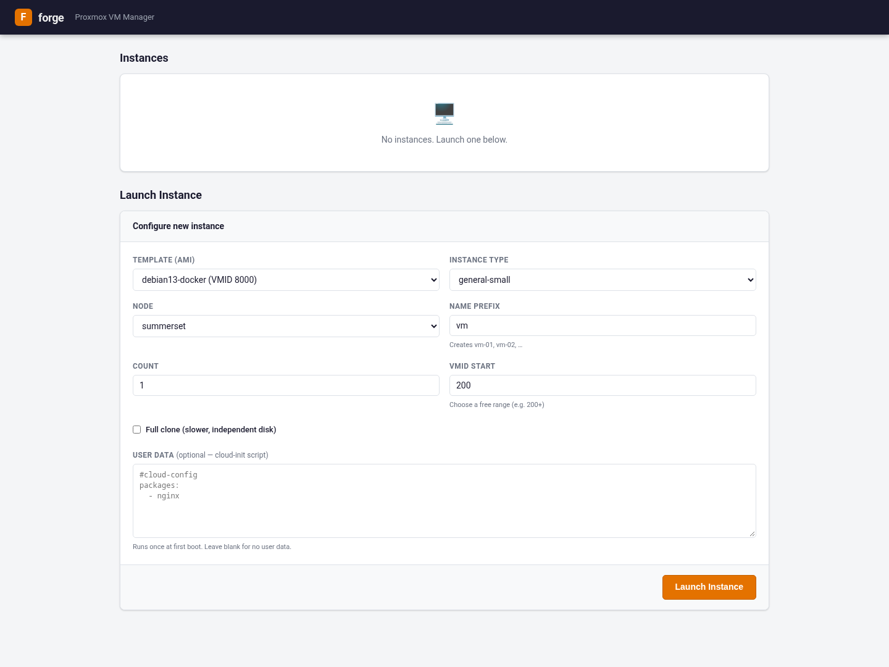
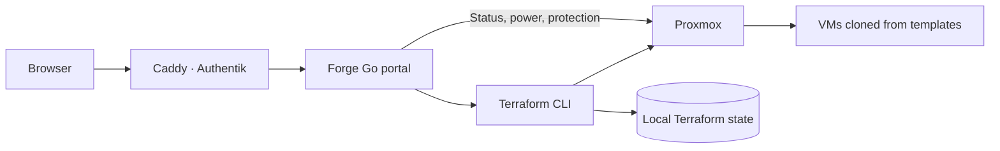

# Forge

[Home](../../README.md) · [Projects](../README.md) · [Proxmox](../../proxmox/README.md)

Forge is my Go web interface for creating Proxmox VMs from templates. It has an
EC2-style launch form, instance status, power controls, and links to the Proxmox
console. Forge is separate from Forgejo, the Git service.

The application source and deployment live in a private repository. These notes
describe the application running in the lab.

The running Forge portal, with no managed instances and the launch form ready
to clone the Debian Docker template.

## The setup

Forge runs in Docker on the application VM, behind Caddy and Authentik forward
authentication. Go renders the HTML pages; Terraform and the `bpg/proxmox`
provider handle provisioning. The portal calls the Proxmox API directly for
status, start, shutdown, and protection changes.

The deployment keeps its Terraform directory, configuration, and protection list
under `/srv/forge`. Configuration supplies the allowed templates, nodes, instance
types, and cloud-init defaults. Optional user data is uploaded as a Proxmox
snippet using the provider's SSH connection.

## Launching a VM

The form has these controls:

| Field | What it controls |
|---|---|
| Template (AMI) | Existing Proxmox template to clone |
| Instance type | A named CPU, memory, and disk-size preset |
| Node | Destination Proxmox node |
| Name prefix | Names such as `test-01`, `test-02` |
| Count | Number of VMs to launch, from 1 to 50 |
| VMID start | First ID in a consecutive, unused range |
| Full clone | Independent disk copy instead of a linked clone |
| User data | Optional cloud-init configuration for first boot |

After **Launch Instance**, the portal checks the configured allowlists and
name/ID conflicts against its Terraform inventory. It merges the new VM entries
with that inventory and starts an asynchronous Terraform apply. The page shows
the active job and placeholder instance rows while provisioning runs. A
refresh-only pass then picks up DHCP addresses from Terraform state.

The instance list covers VMs in Forge's Terraform state, rather than every VM
in the Proxmox cluster. From a populated row I can start or stop a VM, toggle
protection, open its console, or request deletion. Deletion requires the instance
name; a protected instance also requires an additional confirmation phrase.

## State and behavior

- Launch and destroy operations share a lock so two Terraform applies cannot run
  at once. Job status is held in memory.
- The current Terraform module shares template, instance-type, and clone inputs
  across its inventory. Per-VM entries retain the name, ID, and node. Changing a
  shared input on a later launch can also affect existing VMs.
- The protection list is stored in `protected.json`; toggling it also attempts
  to synchronize Proxmox's protection flag.
- **Stop** requests ACPI shutdown with Proxmox's `forceStop=1` fallback.
- Configuration, Terraform state, generated variables, and `protected.json`
  belong together in the private backup. Generated variables include credentials.

For a reusable provisioning example, see [cloning a Debian VM with Terraform](../../proxmox/terraform/README.md).
That guide covers a single VM with its own state and explains the template,
API permissions, and cloud-init requirements.
