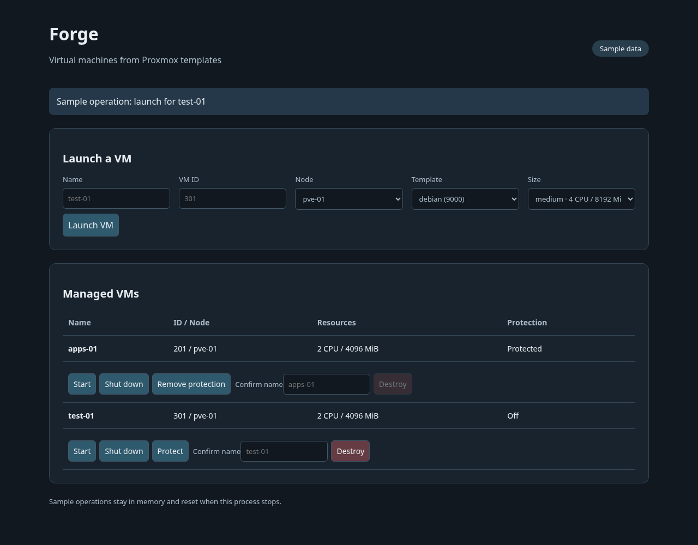

# Forge

[Home](../../README.md) · [Projects](../README.md) · [Proxmox](../../proxmox/README.md)

Forge is a small Go web interface for creating Proxmox VMs from templates. I use
Terraform for provisioning and direct Proxmox API calls for start and shutdown.
Forge is separate from Forgejo, the Git service.



The public portal running with sample data.
[Screenshot review](../../screenshots/forge-demo.review.md).

## The important part

Launching a second VM must preserve the first one's configuration. The portal
loads its complete desired inventory, checks it against Terraform state, and
adds the new VM. Each VM retains its own template, CPU, memory, and protection
settings. A saved plan is applied only when it changes the requested VM in the
expected way.

The [merge and plan checks](engine.go) reject name/ID conflicts, unexpected
updates, replacements, and unrelated deletions. The public portal uses a
dedicated Terraform workspace and one VM per launch. It includes a local sample
mode so the interface can be tried without a Proxmox connection.

## Try the portal

Requirements: Go 1.26+ and Git.

```bash
git clone https://github.com/arviiyer/tamriel-homelab.git
mkdir -p "$HOME/homelab-projects"
cp -R tamriel-homelab/projects/forge "$HOME/homelab-projects/"
cd "$HOME/homelab-projects/forge"
go build -o forge .
./forge -demo -config config.example.json
```

Open <http://127.0.0.1:8088>. Launch `test-01` with VM ID `301`, then check that
the sample `apps-01` is still present with protection enabled. Protect the new
VM, remove its protection, and destroy it by entering its name. Sample changes
are held in memory and reset when you stop the process.

## Connect Proxmox

For real provisioning, use Terraform 1.7+ and a Proxmox VE installation with a
cloud-init template, DHCP, and the QEMU guest agent. The
[Debian template guide](../../proxmox/debian-vm/README.md) covers preparation;
the [Terraform notes](../../proxmox/terraform/README.md) cover provider access
and CA trust. Clones inherit the template's disk layout.

Copy the configuration files:

```bash
cp config.example.json config.json
cp infra/terraform.tfvars.example infra/terraform.tfvars
```

| File | Configure |
|---|---|
| `config.json` | Terraform directory, allowed destination nodes, template IDs/nodes, and CPU/RAM sizes |
| `infra/terraform.tfvars` | Bridge, cloud-init datastore, and absolute path to the guest SSH public key |
| Environment | `PROXMOX_VE_ENDPOINT` and `PROXMOX_VE_API_TOKEN` |

Use a new workspace for Forge. Its state checks expect the supplied root module,
not an existing Terraform project. Do not add an `endpoint` override in tfvars:
the portal passes the same environment endpoint to Terraform and its API client.
The provider and API client both verify TLS. Install your Proxmox CA into the
host's trust store rather than disabling verification.

Set the endpoint and read your private token without putting it into shell history:

```bash
export PROXMOX_VE_ENDPOINT=https://pve-01.example.com:8006/
read -rs -p 'Proxmox API token (user@realm!token=secret): ' PROXMOX_VE_API_TOKEN
echo
export PROXMOX_VE_API_TOKEN
export TF_VAR_endpoint="$PROXMOX_VE_ENDPOINT"
terraform -chdir=infra init
terraform -chdir=infra validate
./forge
```

The account needs the cloning privileges described in the linked Terraform
guide, plus `VM.PowerMgmt` for power controls and `VM.Config.Options` for
protection on the managed VMs. Keep template and destination permissions aligned
with the allowlists in `config.json`.

The portal listens only on loopback. To use it on another Linux host, forward
the port through SSH and open the same local URL:

```bash
ssh -N -L 8088:127.0.0.1:8088 operator@192.0.2.40
```

## First VM

1. Pick an unused VM ID and a name such as `test-01`.
2. Select the configured node, template, and size, then launch it.
3. Wait for the completed message. In Proxmox, check the clone task, cloud-init
   settings, and guest-agent address. Sign in with the configured SSH key as
   `operator`.
4. Launch a second VM with another ID. Check that the first VM's settings remain
   unchanged.
5. Use **Shut down** to request an ACPI shutdown, then check its Proxmox task.

Provisioning runs asynchronously and the page refreshes while busy. Power
controls report that Proxmox accepted the task, not that the guest has finished
booting or shutting down. Shutdown uses `forceStop=0`.

**Protect** sets Proxmox's protection flag through Terraform. A protected VM
cannot be destroyed from the portal until protection is removed. Destruction
also requires the exact VM name in the form. Protection does not prevent a user
with sufficient Proxmox privileges from changing the VM elsewhere.

## Keep it running

After the first successful clone, run the built binary under a user service.
Set its working directory to your project directory and keep the endpoint/token
in a private `EnvironmentFile`:

```ini
[Unit]
Description=Forge VM portal

[Service]
WorkingDirectory=%h/homelab-projects/forge
EnvironmentFile=%h/.config/forge/environment
ExecStart=%h/homelab-projects/forge/forge
Restart=on-failure
UMask=0077

[Install]
WantedBy=default.target
```

Save it as `~/.config/systemd/user/forge.service`, create the environment file
with mode 0600, and run `systemctl --user daemon-reload` followed by
`systemctl --user enable --now forge.service`. Enable user lingering if it should
run after logout. Stop the portal and wait for any active Terraform process
before manual Terraform work or an update.

## Backups and failed operations

Back up `config.json`, `infra/terraform.tfvars`, the provider lock file,
`infra/desired.auto.tfvars.json`, and the Terraform state together while idle.
Keep credentials separately in your private backup. Losing Terraform state does
not remove VMs; starting again with empty state is not a recovery procedure.

If apply fails, the portal keeps the complete desired inventory on disk and
blocks further operations when it disagrees with state. Stop the portal,
inspect `infra/last-error.txt`, and compare Proxmox tasks with
`terraform -chdir=infra show`. With the same provider environment loaded, run
`terraform -chdir=infra plan` and resolve the incomplete operation. Only apply
after reviewing that plan. Start the portal again once state and inventory agree.

| Symptom | Check |
|---|---|
| Unexpected plan change | Existing drift, changed Terraform defaults, or a replacement requirement |
| Clone fails | Template ID/node, datastore permissions, bridge, and unused VM ID |
| State and inventory disagree | A failed apply, manual Terraform change, or incomplete backup restore |
| TLS error | Proxmox endpoint and trusted CA on the portal host |
| Shutdown remains pending | Guest ACPI support and the Proxmox task result |
| Browser refuses an action | Use the loopback URL; reopen the page after restarting the portal |

```bash
go test -race ./...
go vet ./...
terraform -chdir=infra fmt -check
terraform -chdir=infra validate
```

[Portal](main.go) · [Terraform/API adapter](engine.go) · [Tests](engine_test.go)
