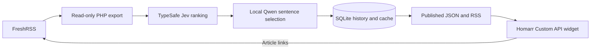

# Daily reading brief

[Home](../../README.md) · [Projects](../README.md) · [FreshRSS](../../apps/freshrss/README.md)

I use FreshRSS to collect articles and a Morning SOC Briefing widget in Homarr
to pick what to read. The `reading-digest` service ranks unread articles and
publishes a short list of source excerpts, with links back to each FreshRSS entry.

The worker source and deployment live in the private application-service
repository. These notes describe the scheduled service running in the lab.

[](../../screenshots/homarr-home.webp)

The October 10 brief on my Homarr dashboard, showing a BleepingComputer article
selected from my FreshRSS subscriptions.

## How it works



1. A systemd timer starts the host-side wrapper at **06:20 America/Toronto**.
   It exports unread entries through FreshRSS's PHP data-access classes without
   changing subscriptions or marking articles read.
2. The worker removes repeated URLs/content and previously featured articles,
   then considers up to 150 candidates from the last seven days.
3. TypeSafe Jev scores relevance, practicality, and depth. A separate scope
   judgment excludes industrial-only coverage from the enterprise-security and
   homelab reading profile. Pairwise comparisons remove overlapping stories
   within the shortlist.
4. Local Qwen selects source sentence IDs. Python validates those IDs and copies
   the original sentences into the brief.
5. The worker saves the completed digest in SQLite, then publishes JSON and RSS.
   Homarr fetches the JSON every five minutes through its Custom API widget.

Jev receives article text and the configured reading interests through an
external API. Excerpt selection runs locally on the application VM's CPU.

## Selection and excerpts

The current profile weights relevance at 50%, practicality at 30%, and depth at
20%, with a minimum combined score of 0.55. It selects up to five articles, with
at most two from one source or topic. Quiet days can produce a shorter list or
a dated empty brief.

I switched from generated summaries to source excerpts after the small model
added unsupported details. Qwen now returns ranked sentence IDs and a topic
from a fixed list. The application copies the source wording and adds a fixed
topic-relevance line. The display labels the text as source excerpts.

Long articles are processed in bounded groups of source sentences. Short
CVE/product entries are retained, and advisory assembly prioritizes distinct
CVE coverage within the excerpt budget. Selection can still miss useful
context, so I open the linked article for the full report.

## The setup

| Component | Running configuration |
|---|---|
| Ranking | TypeSafe Jev 1.13.0 |
| Local model | Qwen3.5-4B Q4_K_M, thinking disabled |
| Inference | llama.cpp b11347, CPU-only, four threads, 8,192-token context |
| Model resources | Four-CPU quota, 4.5 GiB memory limit, no swap |
| Schedule | System-level `reading-digest.timer`, daily at 06:20 Toronto time |
| State | `/srv/reading-digest/data/digest.sqlite` on the VM's local disk |
| Model storage | A separate 16 GiB disk mounted at `/srv/reading-digest/models` |
| Display | Homarr v1.77.2 Custom API widget, refreshed every 300 seconds |

The wrapper starts the model only when inference is needed and stops it after
the run. The feed container stays up with a read-only mount of published files.
It is reachable by Homarr on the private `reading_digest` Docker network, with
no published host port. [The Homarr guide](../../apps/homarr/README.md#daily-reading-brief)
has the widget definition and network setup.

## Keeping it running

On the application VM, these commands check the schedule, latest run, and
published date without generating another brief:

```bash
systemctl list-timers reading-digest.timer
sudo journalctl -u reading-digest.service -n 80 --no-pager
docker exec reading-digest-feed python3 -c \
  'import urllib.request; print(urllib.request.urlopen("http://127.0.0.1:8080/status.json").read().decode())'
```

SQLite stores cached model responses, usage, featured history, and completed
days. A same-day rerun republishes the saved digest without new model calls.
Failed generation keeps the last successful, dated publication visible.

The service has a 25-minute timeout and targets delivery by 06:50. The timer
catches up after downtime. The VM backup includes article exports, SQLite,
and published files; model weights are excluded because the pinned download
can be recreated. Keep the reading profile and runtime credentials with the
private service backup.

Article selection and excerpt quality are still being tuned through daily use.
The remaining work is on the [roadmap](../../ROADMAP.md#projects).
