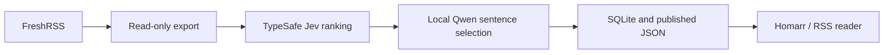

# Morning SOC Briefing

[Home](../../README.md) · [Projects](../README.md) · [FreshRSS](../../apps/freshrss/README.md)

I use FreshRSS to collect articles and Homarr to see a short morning reading
list. This worker ranks unread articles, picks a few useful ones, and copies
source excerpts into a daily brief. Links open the full article in FreshRSS.


The public worker's output on a fresh Homarr installation, using two Debian
advisories and a synthetic restore article.
[Screenshot review](../../screenshots/reading-live.review.md).

## How it works



TypeSafe Jev scores relevance, practicality, and depth, then compares shortlisted
articles for duplicate stories. This step sends article text and the configured
reader interests to an external API. A local Qwen3.5 4B model, served by
llama.cpp on the CPU, selects sentence IDs. Python copies those sentences from
the article and publishes JSON; the feed server derives RSS from the same file.

I switched from generated summaries to excerpts after the small model added
unsupported details. Sentence selection prevents invented prose, but it can
still omit useful context. The reading pilot is active; the latest tuning
preserves short CVE entries and gives them priority in advisory excerpts.

SQLite caches model responses and remembers featured articles. The worker
skips read entries, repeated URLs and content, and already-featured stories.
Limits per source and topic keep one feed from filling the whole list. A failed
ranking or excerpt step keeps the last completed brief. An empty successful
selection publishes an empty list for that day.

The [live check](../../docs/drills/project-checks.md#reading-brief) covers Jev,
local Qwen, FreshRSS links, and the Homarr display. HTML source line wrapping is
collapsed before sentence selection so excerpts retain complete sentences.

## Try it with sample articles

Requirements: Python 3.11+ and Git. This first run does not use an API key,
FreshRSS, Docker, or a model. Download the repository for its examples, then
copy this project into your own working directory:

```bash
git clone https://github.com/arviiyer/tamriel-homelab.git
mkdir -p "$HOME/homelab-projects"
cp -R tamriel-homelab/projects/reading-brief "$HOME/homelab-projects/"
cd "$HOME/homelab-projects/reading-brief"
cp profile.example.json profile.json
python3 brief.py demo --input articles.example.ndjson --data /tmp/reading-brief-demo
python3 serve.py --directory /tmp/reading-brief-demo/public
```

Open <http://127.0.0.1:8094/briefing.json> or subscribe to
<http://127.0.0.1:8094/feed.xml>. Expect two invented articles about restores and
scan freshness. Demo mode uses deterministic selection, so this checks the
publication path rather than model quality. Stop the server with Ctrl+C.

## Connect FreshRSS and the models

The scheduled example runs on the same Linux host as FreshRSS, with Docker
Compose v2, `flock`, a TypeSafe API account, and permission to run Docker.
Allow about 3 GB for the model download and at least 6 GB of available RAM.
The pinned llama.cpp build is CPU-only, Linux amd64. FreshRSS export paths
match the upstream image used in the [FreshRSS guide](../../apps/freshrss/README.md).

Edit `profile.json`:

| Setting | What to change |
|---|---|
| `freshrss_url` | Browser-facing reader URL, for article links |
| `homepage_url` | Browser-facing dashboard URL, used in RSS |
| `timezone` | Your IANA time zone, such as `Etc/UTC` |
| `interests`, `excluded` | Subjects to rank and subjects to omit |
| `weights`, `minimum_score` | Ranking weights, totaling 1, and selection threshold |
| `max_candidates`, `max_articles` | Bounds on ranking calls and the daily list |
| `max_per_source`, `max_per_topic` | Diversity limits |
| `model_url` | Local llama.cpp URL; keep the default with this Compose file |

The source exporter reads seven days of unread entries. If you change
`lookback_days`, also change `--days` in `run-brief.sh`. Jev model IDs and API
availability depend on your TypeSafe account. The API adapter is in
[`Models`](brief.py); it expects the System One question/answer schema.

Create a private environment file using your editor:

```bash
install -d -m 0700 "$HOME/.config/reading-brief"
install -m 0600 /dev/null "$HOME/.config/reading-brief/environment"
```

Set these three values in it, without `export` prefixes:

```text
FRESHRSS_CONTAINER=freshrss
FRESHRSS_USER=reader
TYPESAFE_API_KEY=replace-with-your-key
```

The FreshRSS username is the reader account whose subscriptions you want to use.
The export reads entries without marking them read. On an installation using a
different container web user or CLI path, adjust `run-brief.sh` and `export.php`.

Download the pinned model, then run once:

```bash
python3 download-model.py
mkdir -p data/public
chmod 0755 data data/public
set -a
. "$HOME/.config/reading-brief/environment"
set +a
bash run-brief.sh
docker compose up -d feed
curl --fail http://127.0.0.1:8094/status.json
```

The model download checks both size and SHA-256. The run starts llama.cpp only
after ranking selects articles, and stops it on exit. `status.json` should show
today's date, `mode: live`, and the article count. Read the excerpts alongside
their sources before adjusting your profile. A second run on the same day
republishes the completed brief rather than selecting another list.

The containers run as UID 1000. If your working files belong to another UID,
adjust `user` in `compose.yml`. The feed needs read access to `data/public`;
the model needs read access to `models`.

## Add it to Homarr

Attach Homarr to the reading project's `briefing` network in its own Compose
file. With the default directory name, Docker creates
`reading-brief_briefing`; confirm it with `docker network ls`. Use an external
network declaration in Homarr's Compose file:

```yaml
services:
  homarr:
    networks: [default, briefing]
networks:
  briefing:
    external: true
    name: reading-brief_briefing
```

Recreate Homarr, then follow the
[Custom API widget instructions](../../apps/homarr/README.md#morning-soc-briefing)
with `http://feed:8080` as the source base URL. The JSON shape matches that
widget. Use `/feed.xml` for an RSS reader instead.

## Schedule it

The supplied user units assume `~/homelab-projects/reading-brief`. Edit
`WorkingDirectory` and `ExecStart` if you chose another directory:

```bash
mkdir -p "$HOME/.config/systemd/user"
cp reading-brief.service reading-brief.timer "$HOME/.config/systemd/user/"
systemctl --user daemon-reload
systemctl --user enable --now reading-brief.timer
systemctl --user list-timers reading-brief.timer
```

The timer runs at 06:20 in the host's time zone; `profile.json` determines the
brief's date. Set them consistently. For a user service that runs while logged
out, enable lingering with `sudo loginctl enable-linger "$USER"`.

## Maintenance and troubleshooting

Stop the timer and wait for the current run before backing up `data/brief.sqlite`,
`data/public`, and `profile.json`. Keep the environment file in your private
backup. The model can be downloaded again. Restore into a separate directory
and serve its last brief locally before replacing a working instance.

| Symptom | Check |
|---|---|
| Old brief remains | `journalctl --user -u reading-brief.service`; a failed run intentionally retains it |
| No articles today | Unread entries, age limit, featured history, score, and per-topic limits |
| Jev request fails | API account, credit, model ID, and current System One API schema |
| Local model not ready | Memory availability, model checksum, and `docker compose --profile inference logs model` |
| Long article fails | The worker bounds section size and count instead of publishing a truncated excerpt |
| Feed returns 503 | No completed run or unreadable `data/public/briefing.json` |
| Homarr cannot connect | Shared Docker network and `http://feed:8080`, not the host loopback address |

Changing the excerpt algorithm or model should also change the cache version or
`model_sha256` in the profile. Existing briefs stay historical; a new profile
does not rewrite a completed day's list.

```bash
python3 -m unittest discover -s tests -v
docker compose config --quiet
```

[Worker](brief.py) · [Tests](tests/test_brief.py) ·
[llama.cpp](https://github.com/ggml-org/llama.cpp) ·
[TypeSafe](https://typesafe.ai/)
