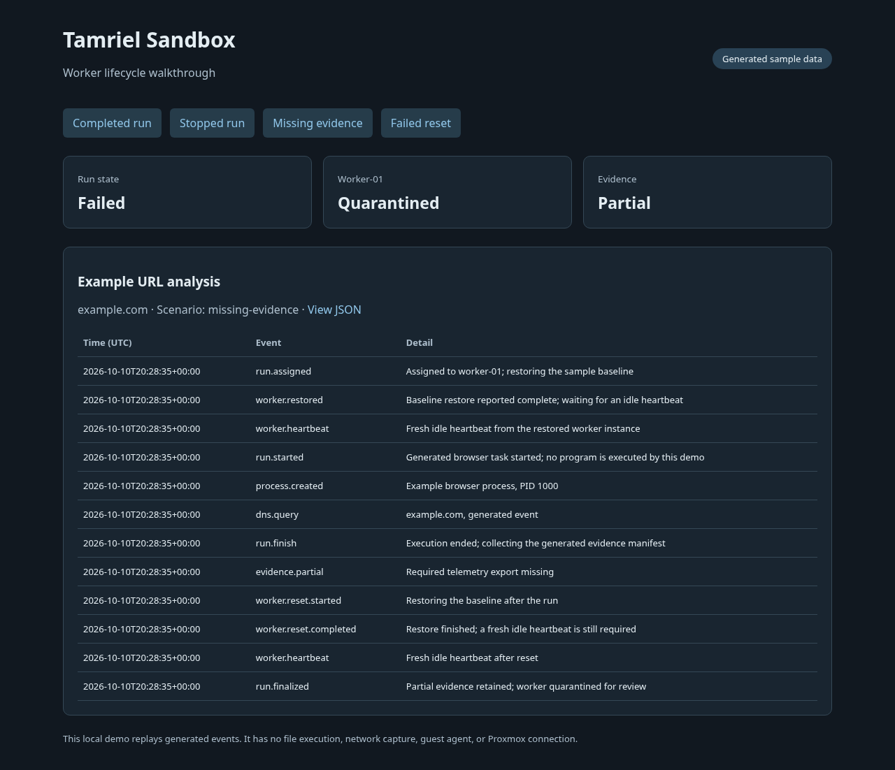
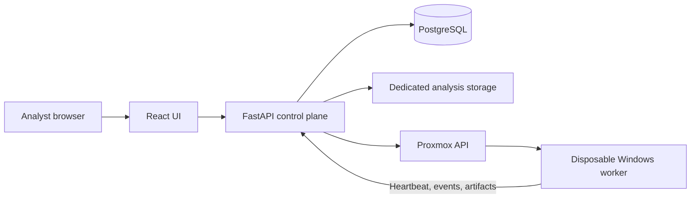

# Tamriel Sandbox

[Home](../../README.md) · [Projects](../README.md) · [Security](../../security/README.md)

Sandbox is my private analysis platform: a React interface, a FastAPI control
plane, and a C# agent in a disposable Windows VM. It brings run history,
process and network telemetry, screenshots, artifacts, and console access into
one place.

The Windows worker and scheduler have been paused since October 1, 2026. The
private UI, API, and database remain available. Browser DNS attribution and
broader reliability work are unfinished.

This directory contains a runnable **workflow demo** with generated events.
It demonstrates collection, reset, and quarantine decisions from the project.
The full analyst application and Windows execution system remain private.



The local workflow demo, showing why a worker remains quarantined after missing
evidence. [Screenshot review](../../screenshots/sandbox-demo.review.md).

## The setup



The control plane runs in its own Linux VM. PostgreSQL holds metadata and the
current work queue. Analysis files live on a separate application-owned disk.
Redis is provisioned but is not the current scheduler's queue.

The Windows worker has a dedicated network segment with access to the required
analysis destinations, separate from normal lab applications. The
[network notes](../../docs/network-and-identity.md) describe that separation.
The validated guest baseline includes the agent, Sysmon, Edge, Chrome, and 7-Zip.

I kept this separate from [Forge](../forge/). Forge creates persistent VMs;
Sandbox repeatedly assigns a run to a worker and restores its baseline. Terraform
is useful for provisioning infrastructure, but a snapshot restore belongs in the
run lifecycle.

## A run from start to finish

1. The analyst submits a file or URL. The API records a queued run.
2. The scheduler assigns an eligible worker, restores its baseline, and waits for
   a fresh heartbeat from the restored agent.
3. The worker executes the task and sends normalized telemetry and screenshots.
4. Completion or an analyst stop moves the run into collection. Ending execution
   alone does not mean the run is finished.
5. The backend checks required evidence and restores the worker again.
6. A successfully reset, healthy worker becomes eligible for another run.
   Failed collection or reset leaves it quarantined for review.

The private UI also supports paginated search, filters, rerun lineage, and a
lifecycle-bound noVNC console. Authentik signs analysts in; the API enforces the
analyst group and session rules. The console closes when the run or analyst
session is no longer eligible. These integrations are not part of the local demo.

## Run the walkthrough

Requirements: Python 3.10+ and Git. No hypervisor, Windows VM, API key, or model
is needed:

```bash
git clone https://github.com/arviiyer/tamriel-homelab.git
cd tamriel-homelab/projects/sandbox
python3 viewer.py
```

Open <http://127.0.0.1:8096>. Select each scenario:

| Scenario | Expected result |
|---|---|
| Completed run | Complete evidence, successful reset, worker ready |
| Stopped run | Collection and reset still occur, run ends stopped |
| Missing evidence | Partial evidence retained, run failed, worker quarantined |
| Failed reset | Collected evidence retained, run failed, worker quarantined |

The page and `/run.json` use the same replay code. All events are generated in
memory; the viewer does not accept submissions, execute files, capture traffic,
or connect to Proxmox. Each request starts a fresh replay.

For terminal output:

```bash
python3 lifecycle.py complete
python3 lifecycle.py missing-evidence
python3 -m unittest discover -s tests -v
```

The [tests](tests/test_lifecycle.py) check that execution waits for readiness,
a completed restore still needs a heartbeat, stopping still collects evidence,
and failure does not return the worker to the queue.

## What the demo leaves to the real integrations

The model accepts a `heartbeat` event as an input. The private backend has to
authenticate that event, correlate it to the restored agent instance, check
freshness, and reconcile it with hypervisor state. Similarly, a generated
`reset-ok` event represents a successfully checked hypervisor task, not merely
an HTTP request being accepted.

A complete installation also needs the Windows agent, baseline creation,
analyst authentication, artifact storage, telemetry normalization, and network
policy. Those deployment files are not included here. The public example is
useful for walking through the state transitions and testing a proposed change
before connecting a real worker.

## Notes from the current work

- Missing telemetry is a failed qualification even when the application reports
  that navigation or execution completed.
- An analyst stop still needs collection and a checked reset.
- Console sessions depend on both analyst authentication and run state.
- Application backups and analysis-data retention are separate decisions. The
  lab backs up the control-plane system disk separately from its analysis disk.
- The latest browser qualification did not establish the required browser-linked
  DNS telemetry. That work remains open; successful page navigation alone did
  not close it.

The viewer has no stored state to back up. Stop it with Ctrl+C. If port 8096 is
already in use, stop the other local viewer or change the bind port in
[`viewer.py`](viewer.py).

[Lifecycle example](lifecycle.py) · [Tests](tests/test_lifecycle.py) ·
[Planned work](../../ROADMAP.md)
