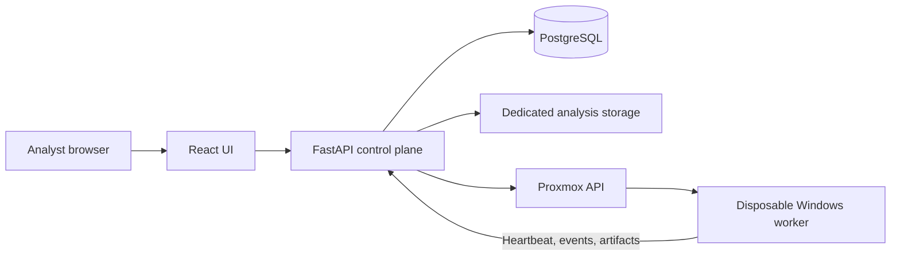

# Tamriel Sandbox

[Home](../../README.md) · [Projects](../README.md) · [Security](../../security/README.md)

Sandbox is my analysis platform: a React interface, a FastAPI control
plane, and a C# agent in a disposable Windows VM. It brings run history,
process and network telemetry, screenshots, artifacts, and console access into
one place.

The source and deployment live in a private repository. These notes cover the
architecture and workflow.

The analyst UI showing a completed benign test run.

## The setup

The control plane runs in its own Linux VM. PostgreSQL holds metadata and the
current work queue. Analysis files live on a separate application-owned disk.
Redis is provisioned but is not the current scheduler's queue.

The Windows worker has a dedicated network segment with access to the required
analysis destinations, separate from normal lab applications. The
[network notes](../../networking/README.md#network-zones) describe that separation.
The guest baseline includes the agent, Sysmon, Edge, Chrome, and 7-Zip.

I kept this separate from [Forge](../forge/). Forge creates persistent VMs;
Sandbox repeatedly assigns a run to a worker and restores its baseline. Terraform
is useful for provisioning infrastructure, but a snapshot restore belongs in the
run lifecycle.

## A run from start to finish

1. The analyst submits a file or URL. The API records a queued run.
2. The scheduler assigns an eligible worker, restores its baseline, and waits for
   a fresh heartbeat from the restored agent.
3. The worker executes the task and sends normalized telemetry and screenshots.
4. Completion or an analyst stop moves the run into collection. Ending execution
   alone does not mean the run is finished.
5. The backend checks required evidence and restores the worker again.
6. A successfully reset, healthy worker becomes eligible for another run.
   Failed collection or reset leaves it quarantined for review.

The UI also supports paginated search, filters, rerun lineage, and a
lifecycle-bound noVNC console. Authentik signs analysts in; the API enforces the
analyst group and session rules. The console closes when the run or analyst
session is no longer eligible.

Process events and collected screenshots from the September 29 test run.

## Notes

Restoring a VM is only part of resetting a worker. The backend also waits for a
fresh, authenticated heartbeat from the restored agent and checks that it belongs
to that agent instance before assigning work. A finished hypervisor task alone
does not establish readiness.

The control-plane system disk is backed up separately from analysis data. That
keeps application recovery independent of the much larger run artifacts.

The Windows worker and scheduler have been paused since October 1, 2026, while
the UI, API, and database remain available. In the latest browser test, navigation
and packet-level DNS worked, but the telemetry did not attribute the DNS events
to the browser process. That work is on the [roadmap](../../ROADMAP.md#projects).
