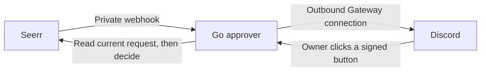

# Seerr Discord Approver

[Home](../../README.md) · [Projects](../README.md) · [Media](../../media/README.md)

I use this bot to handle Seerr requests from Discord. A pending request gets a
message with **Approve** and **Deny** buttons. Only my configured Discord account
can use them, in the configured server and channel. Denial opens a private
confirmation before changing the request.

## Screenshots

Approving a *Big Buck Bunny* request with the lab bot. It includes posters;
the example below uses text messages.


A pending request in Discord.


After approval, the bot confirms the action and Seerr reports the request as
processing.

## How it works



The bot logs into a dedicated local Seerr account with exactly **Manage
Requests** permission. It reads the current request before approving or denying
it. Replayed clicks and already-handled requests do not create another decision.
The webhook stays on a shared Docker network; Discord does not need an inbound
port into the lab.

The [bot](bot.go) includes signed, expiring buttons,
owner/server/channel checks, persistent message records, and a once-per-minute
reconciliation pass.

## Get the files

Requirements: Docker with Compose v2, a working Seerr instance with local login,
a Discord server you manage, and a bot application. For the tests, use Go 1.26+.

```bash
git clone https://github.com/arviiyer/tamriel-homelab.git
mkdir -p "$HOME/homelab-projects"
cp -R tamriel-homelab/projects/seerr-discord-approver "$HOME/homelab-projects/"
cd "$HOME/homelab-projects/seerr-discord-approver"
cp environment.example environment
```

## Set up Discord and Seerr

1. Create an application in the
   [Discord Developer Portal](https://discord.com/developers/applications), add
   a bot, and save its token privately. No privileged Gateway intents are needed.
2. Invite it to your server with the `bot` OAuth2 scope and **View Channels**,
   **Send Messages**, and **Read Message History** permissions in a private
   requests channel. It does not need Administrator.
3. Enable Discord's Developer Mode. Copy the server ID, channel ID, and your user
   ID into `environment`.
4. In Seerr, create a dedicated local user. Give it exactly **Manage Requests**,
   not Admin or the permissions inherited by a normal requesting user. Set its
   email in `SEERR_EMAIL`. The bot rejects other permission masks at login.
5. Set `SEERR_URL` to the address reachable from the bot container, usually
   `http://seerr:5055` on the shared network.

Create the secret files. The bot runs as UID 65532, so grant that UID read access
after editing. This block creates empty files, not credentials:

```bash
install -d -m 0700 secrets
touch secrets/discord secrets/seerr
chmod 0600 secrets/discord secrets/seerr
openssl rand -hex 32 > secrets/webhook
openssl rand -hex 32 > secrets/signing
chmod 0600 secrets/webhook secrets/signing
```

Use an editor to put the bot token in `secrets/discord` and the service account's
password in `secrets/seerr`. The password must be at least 16 characters. Then:

```bash
sudo chown 65532:65532 secrets/discord secrets/seerr secrets/webhook secrets/signing
mkdir -p data
sudo chown 65532:65532 data
sudo chmod 0700 data
```

The webhook secret authenticates Seerr notifications. The separate signing key
authenticates button IDs. Keep both when restoring the bot.

## Connect the containers

Create the shared network once:

```bash
docker network create media-requests
```

Add it to Seerr's existing Compose file, retaining Seerr's other networks:

```yaml
services:
  seerr:
    networks: [default, requests]
networks:
  requests:
    external: true
    name: media-requests
```

Recreate Seerr from its own directory. Then, from this project's directory:

```bash
docker compose config --quiet
docker compose up -d --build
docker compose logs --tail=30 approver
```

The reconciliation pass publishes existing pending requests, so Discord should
show those even before webhook configuration. It also catches missed events.

In **Seerr → Settings → Notifications → Webhook**, enable the agent and set:

| Field | Value |
|---|---|
| Webhook URL | `http://approver:8080/webhooks/seerr` |
| Authorization header | `Bearer ` followed by the contents of `secrets/webhook` |
| Notification types | Pending, Approved, Auto Approved, Declined |

Use this JSON payload template:

```json
{
  "notification_type": "{{notification_type}}",
  "request_id": "{{request_id}}"
}
```

Seerr sends JSON with `Content-Type: application/json`. The generic notification
test has no real request ID, so this endpoint rejects it. Test with a real
pending request instead.

## First request

Submit a request from a Seerr user without automatic approval. In Discord:

1. Check the title and request ID against Seerr.
2. Click **Approve** as the configured owner. Confirm the state in both apps.
3. Submit another request and click **Deny**. **Cancel** leaves it pending;
   **Confirm denial** declines it.
4. Handle a request directly in Seerr. An old Discord button should report it
   handled rather than changing the decision.

The bot checks current state immediately before the mutation. Seerr does not
provide a conditional-write API, so a simultaneous decision from another
Seerr session can still race with it. A connection failure is reported as an
unconfirmed result; the bot does not blindly repeat a write.

## Maintenance

Stop the bot before backing up `data/state.json`, `environment`, and `secrets`.
Restore the files with the same ownership and start it again. State contains
Discord message IDs and button nonces, not Seerr session cookies. A corrupt
state file stops startup instead of silently publishing a second set of buttons.

Update the Go files and module checksums, then run
`docker compose up -d --build`. Keep a copy of the previous files and state for
rollback. Rotate the bot token through Discord if needed; rotating the signing
key invalidates existing buttons. A crash between sending a Discord message and
saving its ID can leave an inert duplicate message, which can be deleted manually.

| Symptom | Check |
|---|---|
| No messages | Bot token, channel permissions, pending requests, and container logs |
| Permission error | Seerr service account has exactly permission value 16 |
| Webhook 401 | Exact `Bearer ` prefix and shared webhook secret |
| Owner rejected | Discord user, channel, and server IDs, not their display names |
| Stale button | Expiration, restored state, and current Seerr status |
| Decision succeeded but message is old | Discord access; reconciliation retries the message update |
| State cannot be saved | UID 65532 owns `data` and it is writable |

## Checks

```bash
go test -race ./...
go vet ./...
```

The tests use a local fake Seerr API to check permissions, CSRF, write retry
behavior, stale decisions, webhook authentication, and signed actions. They
need no Discord or Seerr credentials. Live Discord button testing remains on
the [roadmap](../../ROADMAP.md#projects).

[Seerr client](seerr.go) · [Interaction handler](bot.go) · [Tests](bot_test.go)
