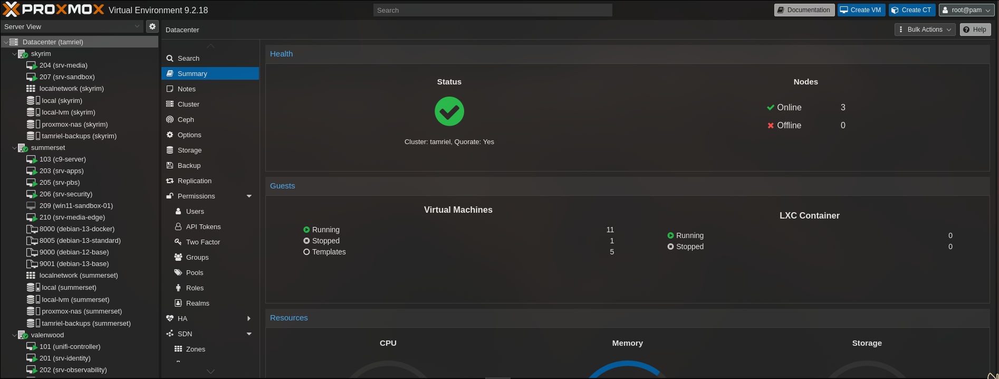

# Proxmox

[Home](../README.md) · [Apps and services](../apps/README.md) ·
[Storage](../storage/README.md)

Tamriel runs on three Proxmox nodes. Debian VMs hold most services, with Docker
Compose inside the VMs and a separate TrueNAS system for shared bulk files.

[Prepare a Debian Docker VM](debian-vm/README.md) ·
[Clone a VM with Terraform](terraform/README.md) ·
[Set up VM backups](../storage/pbs/README.md)

## The cluster

The September cluster view shows the nodes, VMs, and templates.

| Machine | Role |
|---|---|
| GMKtec NucBox K10 | Proxmox node |
| ACEMAGIC K1 | Proxmox node |
| ASUS ROG Ally | Proxmox node with GPU passthrough for media |

[Full hardware specifications](../README.md#hardware)

## Virtual machines

I group the VMs by role:

| Role | What runs there |
|---|---|
| Applications | Syncthing, Immich, Stirling PDF, Homarr, FreshRSS, Forgejo, and the reading brief |
| Media | Jellyfin, Seerr, Servarr, Gluetun, and ClamAV, with GPU passthrough |
| Identity | Authentik and its database |
| Monitoring | Prometheus, Loki, Grafana, Alertmanager, and Uptime Kuma |
| Security | Trivy, Ansible control node, and Falcosidekick |
| CI | Separate Forgejo validation and image-release runners |
| Backups | Proxmox Backup Server |
| Network controller | UniFi Network |
| Games | Minecraft |
| Analysis | Sandbox control plane and a separate Windows worker; analysis is paused |

Forgejo itself runs with the applications; its runners have a dedicated VM. The
media VM has a separate network segment and mounts only the shares it needs.

## Provisioning

The custom [Forge portal](../projects/forge/README.md) uses
Terraform and cloud-init to create VMs from Debian templates. Start and stop
operations use the Proxmox API directly.

The templates include Docker, the QEMU guest agent, NFS support, and the host
monitoring tools. After cloning, the VM needs its own hostname, network assignment,
Tailscale enrollment, and Prometheus target. GPU-specific firmware belongs on the
media guest rather than every template.

Ansible handles SSH policy and updates after provisioning. The published
[Ansible examples](../automation/ansible/README.md) cover that part of the setup.
Terraform state and credentials stay with the provisioner.

The [single-VM Terraform example](terraform/README.md) shows the clone and
cloud-init configuration without the portal.

## GPU passthrough

The ROG Ally passes its AMD GPU to the media VM for Jellyfin VA-API transcoding.
The [Jellyfin guide](../media/jellyfin/README.md#pass-the-gpu-to-the-vm) covers the host, guest,
container, and playback checks. The GPU is assigned to that workload rather than
shared between VMs.

## Supporting devices

The Raspberry Pi 5 runs Pi-hole, Unbound, Caddy, Tailscale, Vaultwarden, SearXNG,
and OpenSpeedTest. It also supplies the cluster's quorum-device vote. The quorum
device participates in voting; it does not host VMs or provide another copy of
their disks.
OPNsense runs on a separate ThinkCentre, and TrueNAS SCALE runs on the UGREEN NAS.
The [hardware list](../README.md#supporting-devices) also includes UPS power
protection.

The UPS currently supplies power only. Its USB monitoring connection and
automatic low-battery shutdown are still on the [roadmap](../ROADMAP.md).

Administration goes through [Tailscale](../networking/README.md#tailscale).
For application data and VM backups, see the
[storage and backup notes](../storage/README.md).

## Notes

- [Lab overview](../docs/architecture.md)
- [Proxmox administration guide](https://pve.proxmox.com/pve-docs/pve-admin-guide.html)
- [Proxmox PCI passthrough reference](https://pve.proxmox.com/wiki/PCI_Passthrough)
- [Next steps](../ROADMAP.md)
