# Screenshots

[Home](../README.md) · [Apps and services](../apps/README.md)

Screenshots from the lab and project examples. Click an image to open it at
full resolution.

## Homarr

Service links, Pi-hole statistics, and the daily reading brief in Homarr v1.

[Homarr setup](../apps/homarr/README.md)

## Immich

[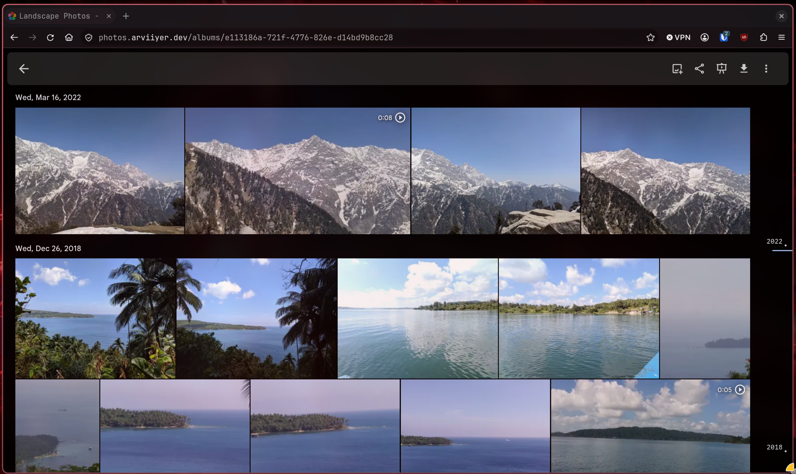](immich-album.webp)

Landscape photos and videos in an album.

[Immich setup](../apps/immich/README.md)

## FreshRSS

[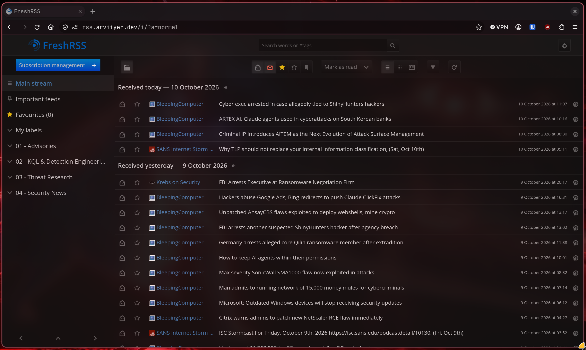](freshrss-reader.webp)

Security feeds grouped by topic.

[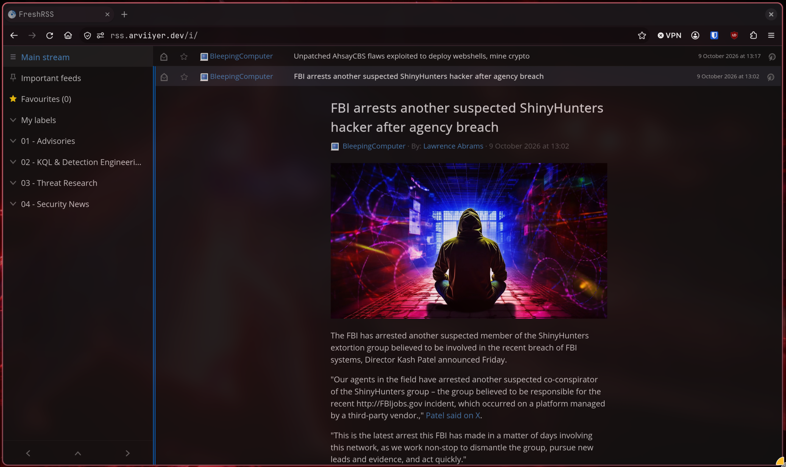](freshrss-article.webp)

An expanded article with its text and image.

[FreshRSS setup](../apps/freshrss/README.md)

## Jellyfin

Media categories and the Continue Watching row.

[Jellyfin setup](../media/jellyfin/README.md)

## Seerr

Browsing trending and popular titles in Seerr.

[Media setup](../media/README.md)

## Host monitoring

The Node Exporter dashboard in Grafana.

[Monitoring setup](../monitoring/README.md)

## TrueNAS storage

Two mirrored data VDEVs, storage usage, and disk health.

[Storage setup](../storage/README.md)

## TrueNAS snapshots

Enabled snapshot tasks with finished status.

[Backup notes](../storage/README.md#backups)

## PBS backup

A VM backup completed with status OK in 4 minutes 38 seconds.

[PBS setup and restores](../storage/pbs/README.md)

## Trivy dashboard

Critical and high findings grouped by image and repository.

[Monitoring setup](../monitoring/README.md)

## Forgejo CI

[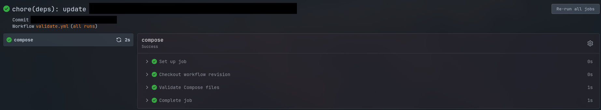](forgejo-validation-run.png)

Compose checks passing on a dependency-update pull request.

[Git and update workflow](../automation/README.md#git-and-updates)

## Discord alert

A Trivy alert for eight new high-severity findings with fixes available.

[Alerting notes](../docs/trivy-alerts.md)

## Proxmox cluster

The September cluster view, with three nodes online and the VM inventory.

[Cluster setup](../proxmox/README.md)

## Project examples

[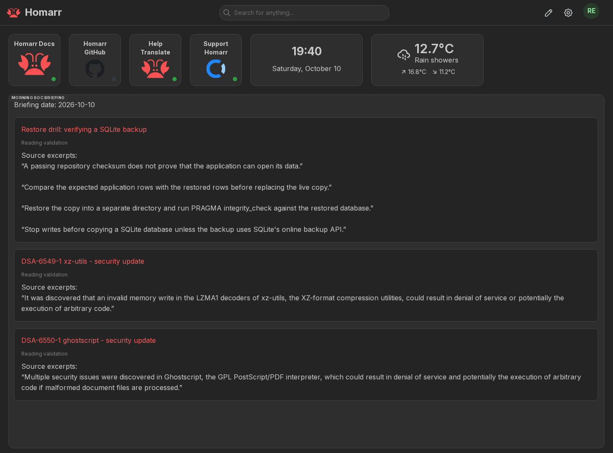](reading-live.webp)

The reading worker's output in Homarr v2, using two Debian advisories and a
sample restore article. [Reading brief setup](../projects/reading-brief/README.md).

[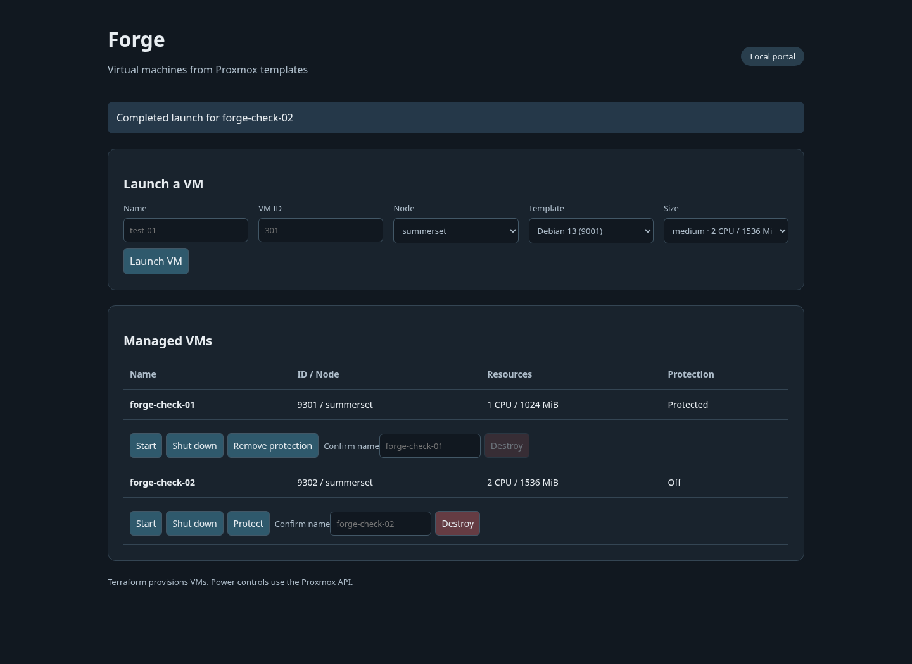](forge-live.webp)

Two test VMs with different CPU and memory settings. [Forge setup](../projects/forge/README.md).

[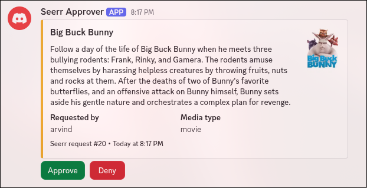](seerr-approval-pending.webp)

A pending *Big Buck Bunny* request in the lab's Discord bot.

[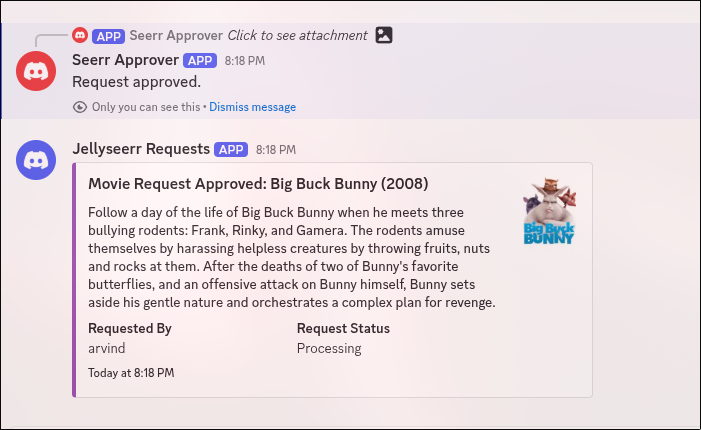](seerr-approved.webp)

After approval, Seerr reports the request as processing. The
[bot example](../projects/seerr-discord-approver/README.md) uses text messages
rather than the posters shown here.

[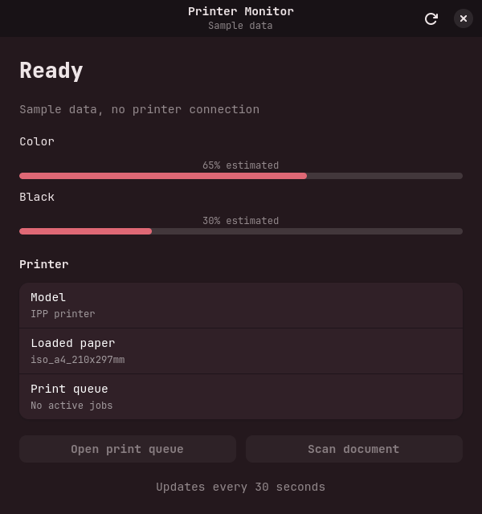](printer-demo.webp)

The GTK window using sample data. [Printer Monitor setup](../projects/printer-monitor/README.md).

[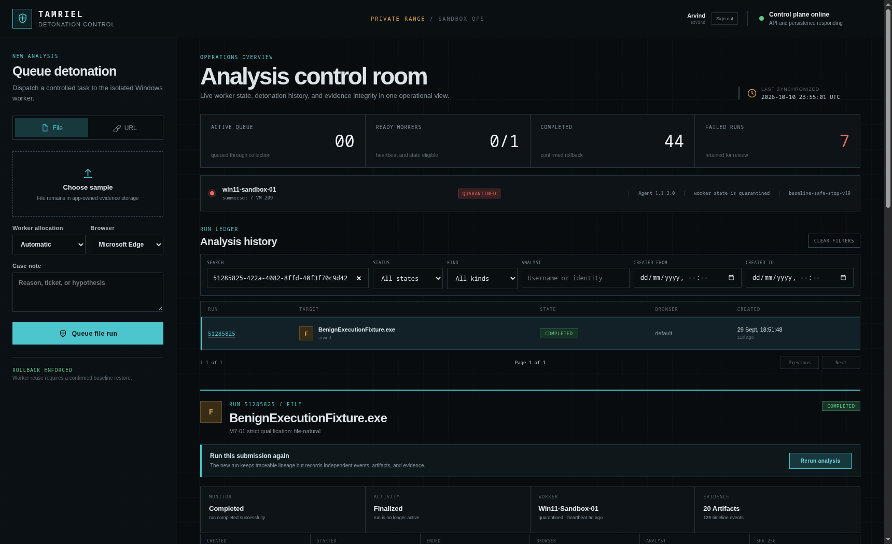](sandbox-overview.webp)

The lab's Sandbox UI showing a completed benign test run.

[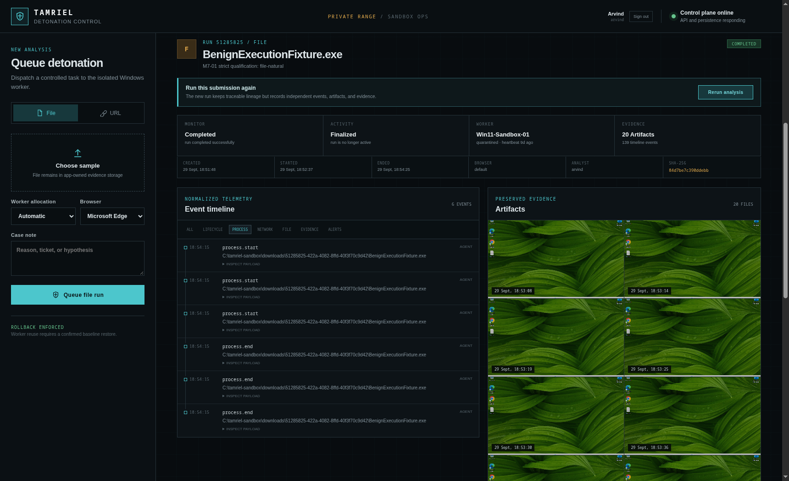](sandbox-run.webp)

Process events and collected screenshots from the same run.
[Sandbox notes](../projects/sandbox/README.md).

The Forge guide also has an optional [sample portal](../projects/forge/README.md#try-it-locally).

## Adding screenshots

- Check the full image, including URLs, tabs, notifications, and personal content.
- Remove secrets and private personal information with a crop or small opaque mask.
- Inspect metadata and OCR output, then check the image visually too.
- Keep useful interface context. Ordinary hostnames, addresses, and metrics can stay.
- Add a short caption and identify sample data or a different app version if relevant.

Keep originals and editing files outside this repository. Force-add only the
final reviewed image, up to 4 MiB. Detailed review notes stay local.
