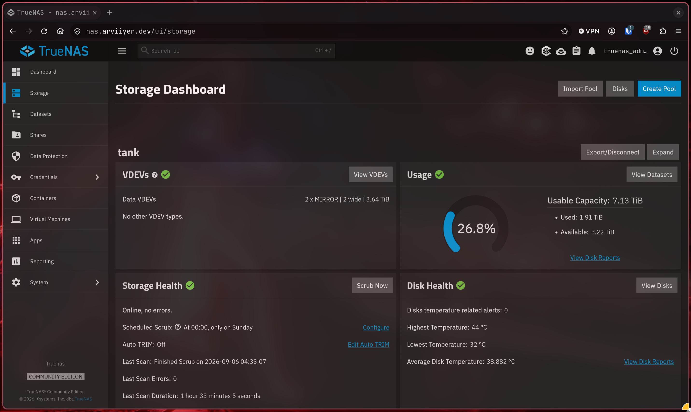
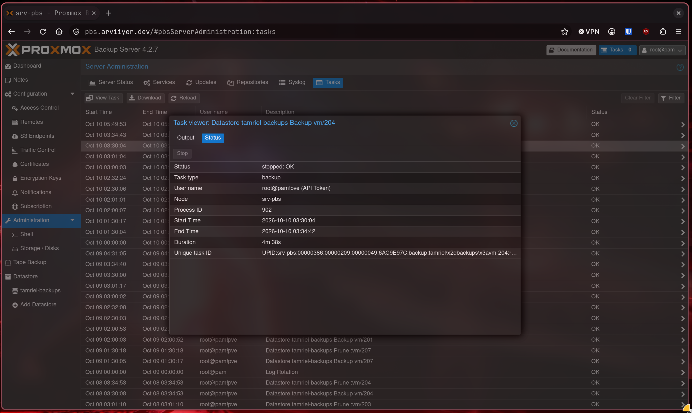
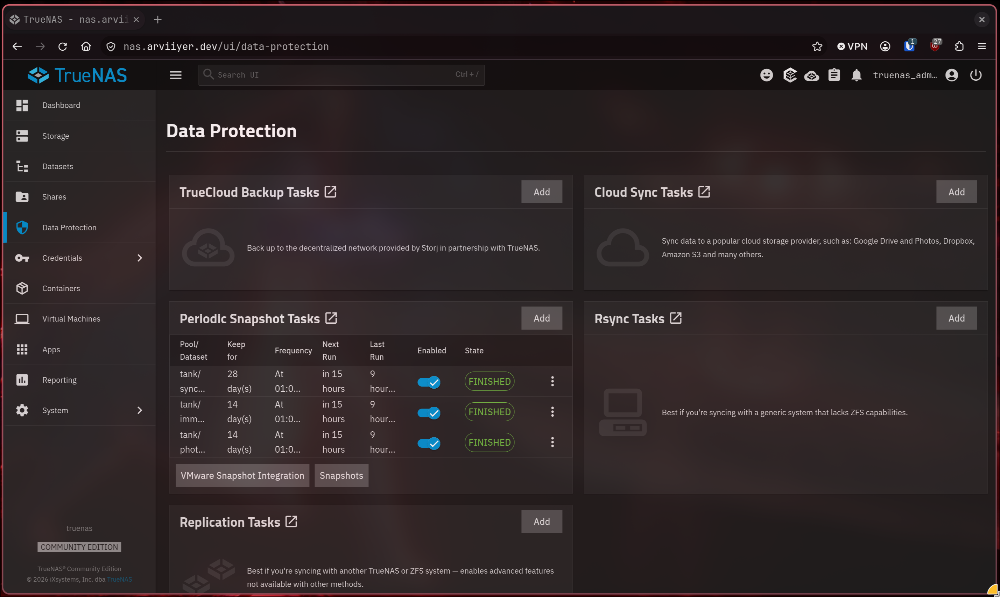

# Storage and backups

[Home](../README.md) · [Apps and services](../apps/README.md) ·
[Proxmox](../proxmox/README.md)

TrueNAS SCALE provides shared storage on the UGREEN NAS. Its four 4 TB hard
drives are arranged as two mirrored pairs. PBS and Restic are the backup tools.

Setup guides: [TrueNAS shares and VM mounts](nfs/README.md) ·
[Proxmox Backup Server](pbs/README.md) · [Restic](restic/README.md)

## Where data lives

| Data | Location |
|---|---|
| Immich PostgreSQL, Forgejo PostgreSQL, Authentik PostgreSQL | Local VM disks |
| FreshRSS SQLite, Homarr appdata, reading-brief SQLite | Local application VM disk |
| Jellyfin and Servarr configuration/databases | Local media VM disk |
| Immich photo library | NAS share |
| Syncthing documents, pictures, and notes | NAS share |
| Media library and downloads | Separate NAS shares |
| PBS datastore | Dedicated NAS share mounted by the backup VM |
| Vaultwarden data | Local Pi storage, with Restic copies |

I keep databases on VM-local disks so a shared-storage outage does not also
take away their database files. Apps such as Immich still need their NAS files,
and both parts need backups.

ZFS supplies snapshots and integrity checks for the shared files. See the
[hardware list](../README.md#storage) for the NAS specifications.

## Backups

The lab uses Proxmox Backup Server and Restic, with VM snapshots and off-host
copies for selected data. These tools address different layers:

- **PBS:** VM backup and restore.
- **Restic:** File backup and restore.
- **Snapshots:** Recovery points on the storage that holds the data.

PBS backs up the service VMs' disks, including their local databases and
configuration. Guest-mounted NFS files are outside those VM disk backups. The
datastore is itself on the NAS, so a PBS backup there shares the NAS's failure
boundary. It is not an off-site copy.

ZFS snapshots cover selected file and photo datasets. Vaultwarden has a local
Restic repository and a copy on another host, with repository checks.

| Application | What needs to be recoverable together |
|---|---|
| Immich | Database, library files, configuration, and matching application version |
| Syncthing | Synced files plus configuration and device identity; sync alone is not a backup |
| Forgejo | Database, repositories, application data, and encryption/signing keys |
| Authentik | Database, configuration, and existing secret key |
| FreshRSS | Consistent SQLite backup, configuration, and custom extensions |
| Homarr | Appdata and the existing encryption key |
| Jellyfin and Servarr | Configuration/databases, matching images, and the separately stored library |
| Vaultwarden | Consistent database, attachments and other vault data, configuration, and backup credentials |

Keep credentials and encryption keys in the private backup process. An image
rollback after a schema migration may also need the matching database backup.

The application guides explain how to check a restored copy. Restore to a
separate instance, then test login, saved data, and writes before replacing
the working application.

## Try a restore

### Restic files

The [Restic guide](restic/README.md) covers application archives, a second
repository on another host, and restoring to a new directory.

### A VM from PBS

The [PBS guide](pbs/README.md#try-a-restore) takes a completed backup through
restore to a new VM ID, isolated startup, and application checks. It also covers
connecting the datastore and scheduling backups.

## Waiting for shared storage

The application and media hosts wait for NFS availability before mounting their
shares. Docker then requires the relevant mounts before starting. That ordering
addresses the race where a VM boots before the NAS is ready.

The [NFS guide](nfs/README.md#wait-for-mounts) shows the mount dependency to add
on a Docker VM.

## Notes

- [TrueNAS documentation](https://www.truenas.com/docs/scale/)
- [PBS administration guide](https://pbs.proxmox.com/docs/)
- [Restic documentation](https://restic.readthedocs.io/en/stable/)
